<!--suppress HtmlDeprecatedAttribute -->

<h1 align="center">💻 PTerm | Pretty Terminal Printer</h1>
<p align="center">A modern Go framework to make beautiful CLIs</p>


<p align="center">

<a href="https://github.com/pterm/pterm/releases" style="text-decoration: none">

</a>

<a href="https://github.com/pterm/pterm/stargazers" style="text-decoration: none">

</a>

<a href="https://github.com/pterm/pterm/fork" style="text-decoration: none">

</a>

<a href="https://opensource.org/licenses/MIT" style="text-decoration: none">

</a>

<a href="https://codecov.io/gh/pterm/pterm" style="text-decoration: none">

</a>

<a href="https://codecov.io/gh/pterm/pterm" style="text-decoration: none">
<!-- unittestcount:start --><!-- unittestcount:end -->
</a>

<br/>

<a href="https://github.com/pterm/pterm/releases" style="text-decoration: none">

</a>

 <a href="https://marvin.ws/twitter">
        
    </a>

<br/>
<br/>

<a href="https://github.com/pterm/pterm/tree/master/_examples/demo/demo" style="text-decoration: none">

</a>
<p align="center"><a href="https://github.com/pterm/pterm/tree/master/_examples/demo/demo" >Show Demo Code</p></p>

</p>

---

<p align="center">
<strong><a href="https://pterm.sh">PTerm.sh</a></strong>
|
<strong><a href="#-installation">Installation</a></strong>
|
<strong><a href="https://docs.pterm.sh/getting-started">Getting Started</a></strong>
|
<strong><a href="https://docs.pterm.sh/">Documentation</a></strong>
|
<strong><a href="https://github.com/pterm/pterm/tree/master/_examples">Examples</a></strong>
|
<strong><a href="https://github.com/pterm/pterm/discussions?discussions_q=category%3AQ%26A">Q&A</a></strong>
|
<strong><a href="https://discord.gg/vE2dNkfAmF">Discord</a></strong>
</p>

---

## 📦 Installation

```sh
go get github.com/pterm/pterm
```

PTerm needs Go 1.27 or newer. Upgrading from v0.12? Follow the
[migration guide](docs/releases/v0.13/BREAKING.md).

## 🚀 Quick start

```go
package main

import "github.com/pterm/pterm"

func main() {
	pterm.Info.Println("Checking caches")

	pterm.Table.WithData(pterm.TableData{
		{"Cache", "Size"},
		{"npm", "1.20 GB"},
		{"go", "2.84 GB"},
	}).Render()

	flow, _ := pterm.Flow.Start("clean")
	flow.Step("Cleaning npm").Success()
	flow.Success("Freed 1.20 GB")
}
```

Every printer is a value such as `pterm.Table` or `pterm.Spinner`. `With*`
methods return a configured copy and never change the original, so a
customized printer can be kept in a variable and reused.

## ⭐ Main Features

| Feature          | Description                                         |
|------------------|-----------------------------------------------------|
| 🪀 Easy to use    | One package, one naming scheme: `pterm.<Printer>.With...()`, then `Println`, `Render`, `Start` or `Show`. |
| 🎨 Themes | Catppuccin Macchiato by default, Latte on light terminals, and any color overridable with `PTERM_THEME_*` variables or `pterm.SetTheme`. |
| 🤹‍♀️ Cross-Platform | Works in Windows Terminal, the legacy Windows console, macOS and Linux terminals and CI logs. Unicode glyphs fall back to ASCII. |
| 🧭 Knows its terminal | Colors turn off when output is piped (`FORCE_COLOR` and `NO_COLOR` win), live printers print only their final state, and prompts return `ErrNotInteractive` without a terminal. |
| 🧵 Race safe | Printers and global settings are safe to use from many goroutines. Live output and log lines never tear each other apart. |
| 🌊 Flow | Steps, progress bars, prompts and any other printer drawn on one rail, for install and deploy scripts. |
| 🧪 Well tested    | <!-- unittestcount2:start -->`648`<!-- unittestcount2:end --> automated tests, with snapshots of every printer in styled and plain form. |
| ✏ Documentation  | Docs on [pkg.go.dev](https://pkg.go.dev/github.com/pterm/pterm), a [styleguide](docs/STYLEGUIDE.md) and an example for every feature in the [examples section](#-examples). |

### Printers (Components)

<div align="center">

<!-- printers:start -->
| Feature | Feature | Feature | Feature | Feature |
| :-------: | :-------: | :-------: | :-------: | :-------: |
| Area <br/> [(Examples)](https://github.com/pterm/pterm/tree/master/_examples/area) |Badge <br/> [(Examples)](https://github.com/pterm/pterm/tree/master/_examples/badge) |Barchart <br/> [(Examples)](https://github.com/pterm/pterm/tree/master/_examples/barchart) |Bigtext <br/> [(Examples)](https://github.com/pterm/pterm/tree/master/_examples/bigtext) |Box <br/> [(Examples)](https://github.com/pterm/pterm/tree/master/_examples/box) |
| Bulletlist <br/> [(Examples)](https://github.com/pterm/pterm/tree/master/_examples/bulletlist) |Callout <br/> [(Examples)](https://github.com/pterm/pterm/tree/master/_examples/callout) |Center <br/> [(Examples)](https://github.com/pterm/pterm/tree/master/_examples/center) |Confirm <br/> [(Examples)](https://github.com/pterm/pterm/tree/master/_examples/confirm) |Continue <br/> [(Examples)](https://github.com/pterm/pterm/tree/master/_examples/continue) |
| Definitions <br/> [(Examples)](https://github.com/pterm/pterm/tree/master/_examples/definitions) |Flow <br/> [(Examples)](https://github.com/pterm/pterm/tree/master/_examples/flow) |Header <br/> [(Examples)](https://github.com/pterm/pterm/tree/master/_examples/header) |Heatmap <br/> [(Examples)](https://github.com/pterm/pterm/tree/master/_examples/heatmap) |Keyhints <br/> [(Examples)](https://github.com/pterm/pterm/tree/master/_examples/keyhints) |
| Keyvalue <br/> [(Examples)](https://github.com/pterm/pterm/tree/master/_examples/keyvalue) |Logger <br/> [(Examples)](https://github.com/pterm/pterm/tree/master/_examples/logger) |Meter <br/> [(Examples)](https://github.com/pterm/pterm/tree/master/_examples/meter) |Multi <br/> [(Examples)](https://github.com/pterm/pterm/tree/master/_examples/multi) |Multiselect <br/> [(Examples)](https://github.com/pterm/pterm/tree/master/_examples/multiselect) |
| Panel <br/> [(Examples)](https://github.com/pterm/pterm/tree/master/_examples/panel) |Paragraph <br/> [(Examples)](https://github.com/pterm/pterm/tree/master/_examples/paragraph) |Prefix <br/> [(Examples)](https://github.com/pterm/pterm/tree/master/_examples/prefix) |Progressbar <br/> [(Examples)](https://github.com/pterm/pterm/tree/master/_examples/progressbar) |Rule <br/> [(Examples)](https://github.com/pterm/pterm/tree/master/_examples/rule) |
| Section <br/> [(Examples)](https://github.com/pterm/pterm/tree/master/_examples/section) |Select <br/> [(Examples)](https://github.com/pterm/pterm/tree/master/_examples/select) |Slog <br/> [(Examples)](https://github.com/pterm/pterm/tree/master/_examples/slog) |Sparkline <br/> [(Examples)](https://github.com/pterm/pterm/tree/master/_examples/sparkline) |Spinner <br/> [(Examples)](https://github.com/pterm/pterm/tree/master/_examples/spinner) |
| Style <br/> [(Examples)](https://github.com/pterm/pterm/tree/master/_examples/style) |Table <br/> [(Examples)](https://github.com/pterm/pterm/tree/master/_examples/table) |Text <br/> [(Examples)](https://github.com/pterm/pterm/tree/master/_examples/text) |Textinput <br/> [(Examples)](https://github.com/pterm/pterm/tree/master/_examples/textinput) |Theme <br/> [(Examples)](https://github.com/pterm/pterm/tree/master/_examples/theme) |
| Tree <br/> [(Examples)](https://github.com/pterm/pterm/tree/master/_examples/tree) | | | | |
<!-- printers:end -->

</div>

---

<div align="center">

### 🦸‍♂️ Sponsors


---

</div>

## 🧪 Examples

<p align="center">
<table>
<tbody>
<td align="center">
<br>
<a href="https://github.com/pterm/pterm/tree/master/_examples">‼️ You can find all the examples, in a much better structure and their source code, in "_examples" ‼️</a><br>
<sub>Click on the link above to show the examples folder.</sub>

</td>
</tbody>
</table>
</p>

<!-- examples:start -->
### area/demo


<details>

<summary>SHOW SOURCE</summary>

```go
package main

import (
	"fmt"
	"strings"
	"time"

	"github.com/pterm/pterm"
)

func main() {
	services := []string{"api", "worker", "scheduler", "web"}
	healthy := 0

	// An area redraws any text in place. Here it shows a small health board
	// that updates as services come up.
	area, _ := pterm.Area.Start(board(services, healthy))

	for healthy < len(services) {
		time.Sleep(700 * time.Millisecond)

		healthy++
		area.Update(board(services, healthy))
	}

	// The last content stays on screen.
	area.Stop()
}

// board renders one line per service, with the first n marked as healthy.
func board(services []string, n int) string {
	var b strings.Builder

	fmt.Fprintf(&b, "Waiting for services %s\n", pterm.ToneMuted.Sprintf("%d/%d", n, len(services)))

	for i, s := range services {
		if i < n {
			b.WriteString("  " + pterm.ToneSuccess.Sprint("up  ") + " " + s + "\n")
		} else {
			b.WriteString("  " + pterm.ToneMuted.Sprint("down") + " " + s + "\n")
		}
	}

	return b.String()
}
```

</details>

### area/fullscreen-center


<details>

<summary>SHOW SOURCE</summary>

```go
package main

import (
	"time"

	"github.com/pterm/pterm"
)

func main() {
	// Fullscreen fills the terminal height and Center puts the content in
	// the middle of it, which suits a countdown or a splash screen.
	area, _ := pterm.Area.WithFullscreen().WithCenter().WithRemoveWhenDone().Start()

	for i := 5; i > 0; i-- {
		area.Update(pterm.TonePrimary.Bold().Sprintf("Launching in %d", i))
		time.Sleep(time.Second)
	}

	area.Stop()
	pterm.Success.Println("Launched")
}
```

</details>

### badge/demo

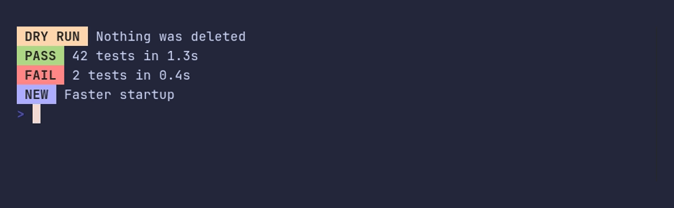

<details>

<summary>SHOW SOURCE</summary>

```go
package main

import (
	"fmt"

	"github.com/pterm/pterm"
)

func main() {
	// Badges label the state or kind of something. Sprint returns the
	// badge as a string, so it fits into any line of output.
	fmt.Println(pterm.Badge.WithTone(pterm.ToneWarning).Sprint("dry run"), "Nothing was deleted")
	fmt.Println(pterm.Badge.WithTone(pterm.ToneSuccess).Sprint("pass"), "42 tests in 1.3s")
	fmt.Println(pterm.Badge.WithTone(pterm.ToneError).Sprint("fail"), "2 tests in 0.4s")
	fmt.Println(pterm.Badge.Sprint("new"), "Faster startup")
}
```

</details>

### badge/chip

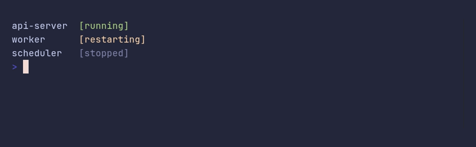

<details>

<summary>SHOW SOURCE</summary>

```go
package main

import (
	"fmt"

	"github.com/pterm/pterm"
)

func main() {
	// Chips are the quiet variant: the text in the badge's tone, between
	// brackets. They work well for tags next to list items.
	chip := pterm.Badge.Chip()

	fmt.Println("api-server ", chip.WithTone(pterm.ToneSuccess).Sprint("running"))
	fmt.Println("worker     ", chip.WithTone(pterm.ToneWarning).Sprint("restarting"))
	fmt.Println("scheduler  ", chip.WithTone(pterm.ToneMuted).Sprint("stopped"))
}
```

</details>

### barchart/demo

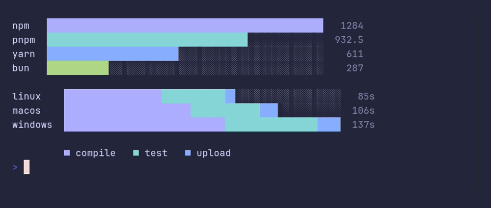

<details>

<summary>SHOW SOURCE</summary>

```go
package main

import "github.com/pterm/pterm"

func main() {
	// Weekly downloads per package manager. Each bar takes the next tone
	// of the theme's series cycle, and the values line up on the right.
	pterm.BarChart.WithBars(pterm.Bars{
		{Label: "npm", Value: 1284},
		{Label: "pnpm", Value: 932.5},
		{Label: "yarn", Value: 611},
		{Label: "bun", Value: 287},
	}).Render()

	pterm.Println()

	// Several series per label become a stacked bar with a legend.
	pterm.BarChart.
		WithSeries("compile", "test", "upload").
		WithStacked().
		WithUnit("s").
		WithGroups(pterm.BarGroups{
			{Label: "linux", Values: []float64{48, 31, 6}},
			{Label: "macos", Values: []float64{62, 35, 9}},
			{Label: "windows", Values: []float64{81, 44, 12}},
		}).
		Render()
}
```

</details>

### barchart/custom

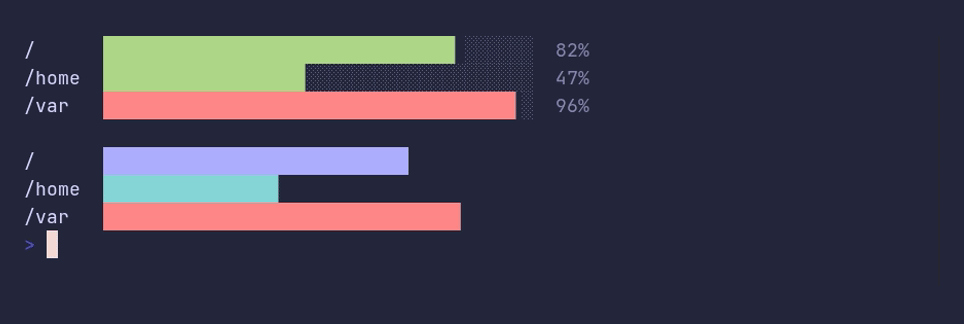

<details>

<summary>SHOW SOURCE</summary>

```go
package main

import (
	"fmt"

	"github.com/pterm/pterm"
)

func main() {
	usage := pterm.Bars{
		{Label: "/", Value: 0.82},
		{Label: "/home", Value: 0.47},
		// A tone on a single bar wins over the chart's tones.
		{Label: "/var", Value: 0.96, Tone: pterm.ToneError},
	}

	// A fixed range makes bars comparable between charts, a custom format
	// prints the values as percentages, and the width includes labels and
	// values.
	pterm.BarChart.
		WithBars(usage).
		WithRange(0, 1).
		WithTone(pterm.ToneSuccess).
		WithFormat(func(v float64) string { return fmt.Sprintf("%.0f%%", v*100) }).
		WithWidth(50).
		Render()

	pterm.Println()

	// Without track and values, only the bars remain.
	pterm.BarChart.WithBars(usage).WithRange(0, 1).WithShowTrack(false).WithShowValues(false).WithWidth(40).Render()
}
```

</details>

### barchart/grouped


<details>

<summary>SHOW SOURCE</summary>

```go
package main

import "github.com/pterm/pterm"

func main() {
	// Each group holds one value per series, in the order of WithSeries.
	// The series names make up the legend under the chart.
	pterm.BarChart.
		WithSeries("2025", "2026").
		WithGroups(pterm.BarGroups{
			{Label: "Q1", Values: []float64{42, 51}},
			{Label: "Q2", Values: []float64{38, 57}},
			{Label: "Q3", Values: []float64{45, 63.5}},
		}).
		WithUnit("k").
		Render()
}
```

</details>

### barchart/negative


<details>

<summary>SHOW SOURCE</summary>

```go
package main

import "github.com/pterm/pterm"

func main() {
	// Losses grow to the left of the zero axis, gains to the right.
	pterm.BarChart.WithBars(pterm.Bars{
		{Label: "Q1", Value: 12.5},
		{Label: "Q2", Value: -4},
		{Label: "Q3", Value: -9.25},
		{Label: "Q4", Value: 18},
	}).WithUnit("%").Render()
}
```

</details>

### barchart/stacked

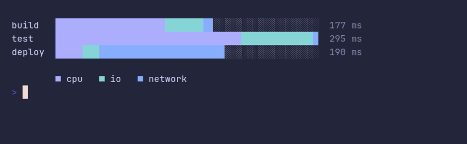

<details>

<summary>SHOW SOURCE</summary>

```go
package main

import "github.com/pterm/pterm"

func main() {
	// Stacked bars show how a total splits up. The value on the right is
	// the total of each bar.
	pterm.BarChart.
		WithSeries("cpu", "io", "network").
		WithStacked().
		WithUnit(" ms").
		WithGroups(pterm.BarGroups{
			{Label: "build", Values: []float64{120, 45, 12}},
			{Label: "test", Values: []float64{210, 80, 5}},
			{Label: "deploy", Values: []float64{30, 20, 140}},
		}).
		Render()
}
```

</details>

### barchart/vertical

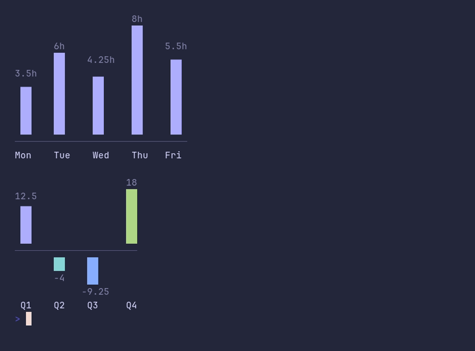

<details>

<summary>SHOW SOURCE</summary>

```go
package main

import "github.com/pterm/pterm"

func main() {
	// Vertical charts draw columns over a baseline, exact to an eighth of
	// a line. One tone for all columns keeps a time series calm.
	pterm.BarChart.WithVertical().WithTone(pterm.TonePrimary).WithBars(pterm.Bars{
		{Label: "Mon", Value: 3.5},
		{Label: "Tue", Value: 6},
		{Label: "Wed", Value: 4.25},
		{Label: "Thu", Value: 8},
		{Label: "Fri", Value: 5.5},
	}).WithUnit("h").Render()

	pterm.Println()

	// Negative values hang below the baseline.
	pterm.BarChart.WithVertical().WithHeight(6).WithBars(pterm.Bars{
		{Label: "Q1", Value: 12.5},
		{Label: "Q2", Value: -4},
		{Label: "Q3", Value: -9.25},
		{Label: "Q4", Value: 18},
	}).Render()
}
```

</details>

### bigtext/demo


<details>

<summary>SHOW SOURCE</summary>

```go
package main

import "github.com/pterm/pterm"

func main() {
	// Big letters for title screens, in a gradient from Primary to Accent.
	pterm.BigText.Println("PTerm")
}
```

</details>

### bigtext/gradient

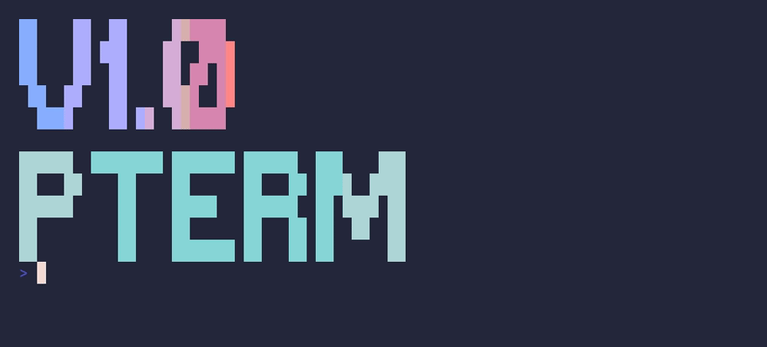

<details>

<summary>SHOW SOURCE</summary>

```go
package main

import "github.com/pterm/pterm"

func main() {
	// A gradient can run through any number of tones.
	pterm.BigText.WithGradient(pterm.ToneInfo, pterm.TonePrimary, pterm.ToneError).Println("v1.0")

	pterm.Println()

	// The offset shifts the gradient by a share of the text width. It
	// bounces at the ends, so stepping it from 0 to 2 in a loop sweeps the
	// colors across the text and back without a jump.
	pterm.BigText.WithGradientOffset(0.5).Println("PTerm")
}
```

</details>

### bigtext/letters

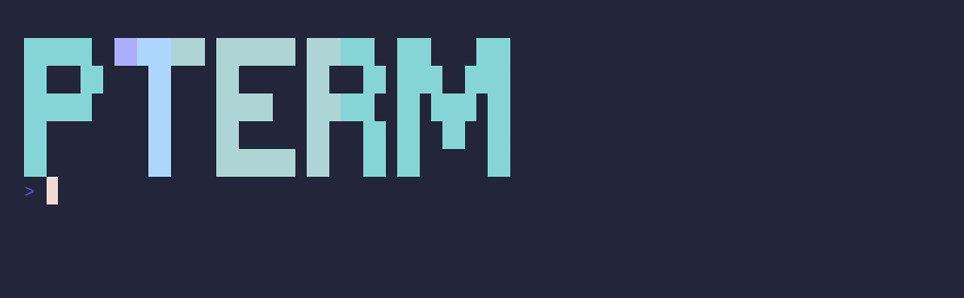

<details>

<summary>SHOW SOURCE</summary>

```go
package main

import "github.com/pterm/pterm"

func main() {
	// Letters with a style of their own keep it; the rest follow the
	// printer's gradient.
	pterm.BigText.WithLetters(
		pterm.LettersFromString("P", pterm.ToneAccent.Style()),
		pterm.LettersFromString("Term"),
	).Render()
}
```

</details>

### bigtext/tone

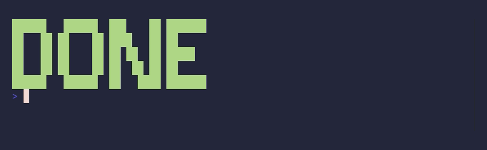

<details>

<summary>SHOW SOURCE</summary>

```go
package main

import "github.com/pterm/pterm"

func main() {
	// One tone instead of the gradient.
	pterm.BigText.WithTone(pterm.ToneSuccess).Println("Done")
}
```

</details>

### box/demo

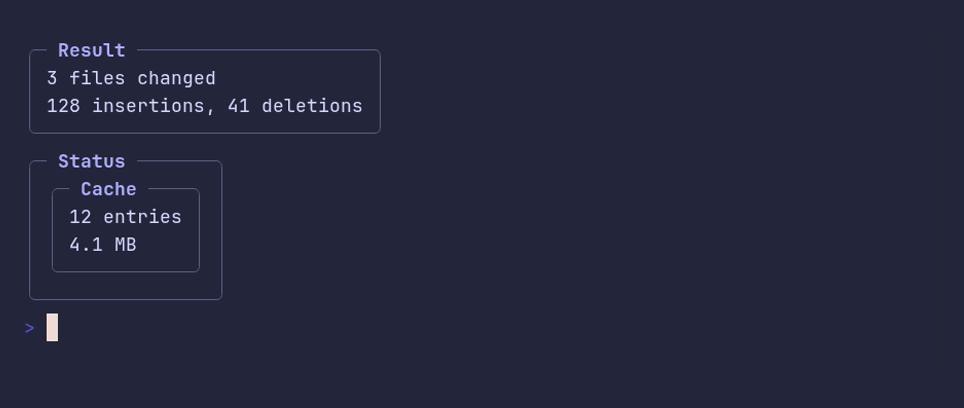

<details>

<summary>SHOW SOURCE</summary>

```go
package main

import "github.com/pterm/pterm"

func main() {
	// A box frames text that belongs together. The title sits in the
	// border, so the frame costs no extra line.
	pterm.Box.WithTitle("Result").Println("3 files changed\n128 insertions, 41 deletions")

	// Boxes are text printers, so their output can go into other printers,
	// even into another box.
	inner := pterm.Box.WithTitle("Cache").Sprint("12 entries\n4.1 MB")
	pterm.Box.WithTitle("Status").Println(inner)
}
```

</details>

### box/padding

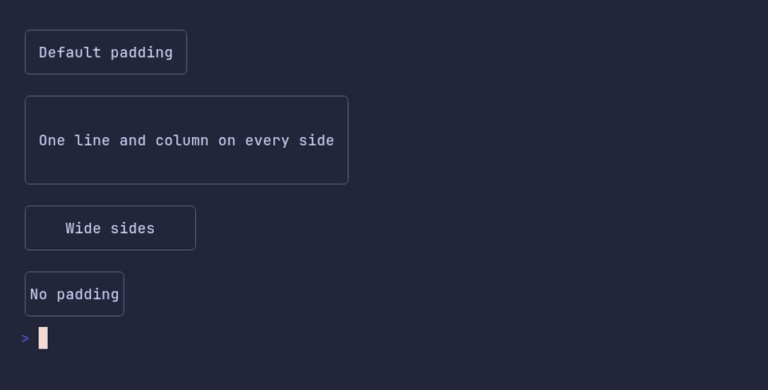

<details>

<summary>SHOW SOURCE</summary>

```go
package main

import "github.com/pterm/pterm"

func main() {
	// By default there is one column of space left and right of the text.
	pterm.Box.Println("Default padding")

	// Padding can be set for all sides at once or for each side.
	pterm.Box.WithPadding(1).Println("One line and column on every side")
	pterm.Box.WithHorizontalPadding(4).Println("Wide sides")
	pterm.Box.WithLeftPadding(0).WithRightPadding(0).Println("No padding")
}
```

</details>

### box/title-position

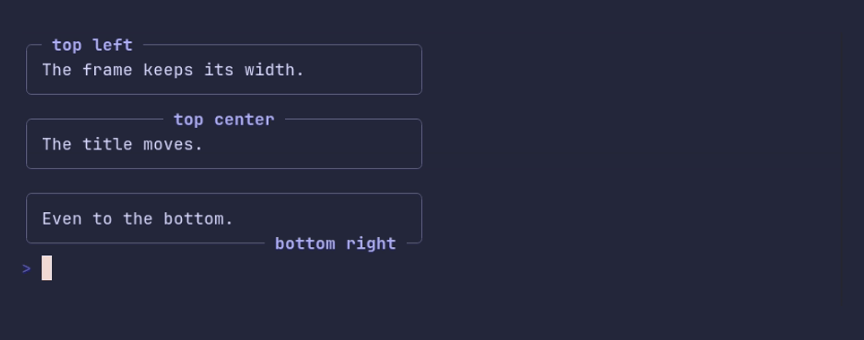

<details>

<summary>SHOW SOURCE</summary>

```go
package main

import "github.com/pterm/pterm"

func main() {
	// The title can sit on the left, in the center or on the right, at the
	// top or at the bottom of the frame.
	pterm.Box.WithTitle("top left").WithWidth(40).Println("The frame keeps its width.")
	pterm.Box.WithTitle("top center").WithTitlePosition(pterm.BoxTitleTopCenter).WithWidth(40).Println("The title moves.")
	pterm.Box.WithTitle("bottom right").WithTitlePosition(pterm.BoxTitleBottomRight).WithWidth(40).Println("Even to the bottom.")
}
```

</details>

### bulletlist/demo


<details>

<summary>SHOW SOURCE</summary>

```go
package main

import "github.com/pterm/pterm"

func main() {
	// Level nests an item under the one before it. Long items wrap under
	// their own text, not under the bullet.
	pterm.BulletList.WithItems([]pterm.BulletListItem{
		{Text: "Measure what can be freed"},
		{Level: 1, Text: "npm, bun and pip caches"},
		{Level: 1, Text: "Docker images that no container uses"},
		{Text: "Ask before deleting anything"},
		{Text: "Clean up and print a summary of how much space came back, grouped by tool"},
	}).Render()
}
```

</details>

### bulletlist/custom-bullets


<details>

<summary>SHOW SOURCE</summary>

```go
package main

import "github.com/pterm/pterm"

func main() {
	glyphs := pterm.CurrentGlyphs()

	// Items can bring their own bullet and tone, which turns a list into a
	// small checklist. Glyphs come from the glyph set, so they fall back to
	// ASCII on terminals without Unicode.
	pterm.BulletList.WithItems([]pterm.BulletListItem{
		{Text: "Config file found", Bullet: glyphs.Success, Tone: pterm.ToneSuccess},
		{Text: "Cache is stale", Bullet: glyphs.Warning, Tone: pterm.ToneWarning},
		{Text: "Token expired", Bullet: glyphs.Error, Tone: pterm.ToneError},
		{Level: 1, Text: "Run `mjw login` to get a new one"},
	}).Render()
}
```

</details>

### bulletlist/ordered


<details>

<summary>SHOW SOURCE</summary>

```go
package main

import "github.com/pterm/pterm"

func main() {
	// An ordered list numbers its items. Every level counts on its own and
	// starts again under each parent.
	pterm.BulletList.WithOrdered().WithItems([]pterm.BulletListItem{
		{Text: "Install the CLI"},
		{Text: "Log in"},
		{Level: 1, Text: "Open the link that is printed"},
		{Level: 1, Text: "Confirm the code in the browser"},
		{Text: "Deploy your first project"},
	}).Render()
}
```

</details>

### callout/demo

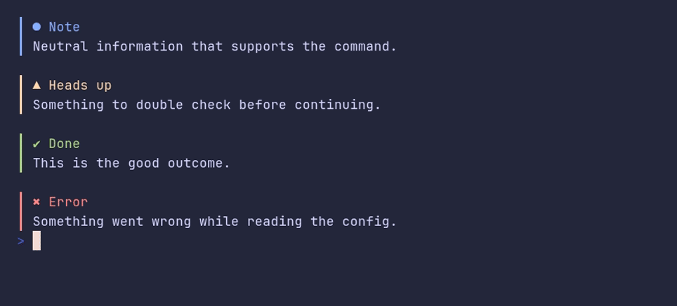

<details>

<summary>SHOW SOURCE</summary>

```go
package main

import "github.com/pterm/pterm"

func main() {
	pterm.Callout.Note("Note").Println("Neutral information that supports the command.")
	pterm.Println()
	pterm.Callout.Warn("Heads up").Println("Something to double check before continuing.")
	pterm.Println()
	pterm.Callout.Tip("Done").Println("This is the good outcome.")
	pterm.Println()
	pterm.Callout.Danger("Error").Println("Something went wrong while reading the config.")
}
```

</details>

### callout/hint


<details>

<summary>SHOW SOURCE</summary>

```go
package main

import "github.com/pterm/pterm"

func main() {
	// A hint is a muted last line, good for the cause of an error or a
	// next step.
	pterm.Callout.Danger("Error").
		WithHint("caused by: ENOENT: no such file").
		Println("Something went wrong while reading the config\nRun `app debug doctor` to see where app is looking.")
}
```

</details>

### center/demo

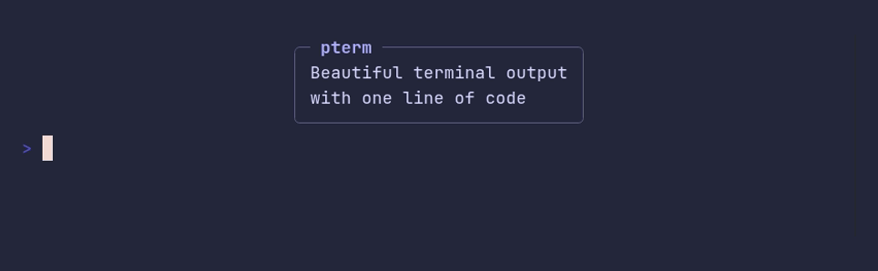

<details>

<summary>SHOW SOURCE</summary>

```go
package main

import "github.com/pterm/pterm"

func main() {
	// Center moves text to the middle of the terminal. By default the text
	// moves as one block, so the lines of a box stay aligned.
	box := pterm.Box.WithTitle("pterm").Sprint("Beautiful terminal output\nwith one line of code")
	pterm.Center.Println(box)
}
```

</details>

### center/each-line


<details>

<summary>SHOW SOURCE</summary>

```go
package main

import "github.com/pterm/pterm"

func main() {
	// For loose text, every line can be centered on its own.
	pterm.Center.WithCenterEachLineSeparately().Println("Thanks for trying pterm\nStar it on GitHub if you like it\nhttps://github.com/pterm/pterm")
}
```

</details>

### confirm/demo


<details>

<summary>SHOW SOURCE</summary>

```go
package main

import "github.com/pterm/pterm"

func main() {
	// "y" and "n" answer at once. The arrow keys move between the answers
	// and enter takes the highlighted one, which starts on the default.
	ok, _ := pterm.Confirm.
		WithDefaultValue(true).
		Show("Delete 23 caches?")

	if !ok {
		pterm.Info.Println("Nothing was deleted")
		return
	}

	pterm.Success.Println("Deleted 23 caches")
}
```

</details>

### confirm/custom-answers

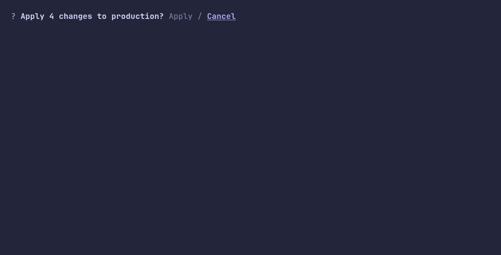

<details>

<summary>SHOW SOURCE</summary>

```go
package main

import "github.com/pterm/pterm"

func main() {
	// The answers can say what they do. Their first letters become the
	// shortcuts, here "a" for Apply and "c" for Cancel.
	apply, _ := pterm.Confirm.
		WithConfirmText("Apply").
		WithRejectText("Cancel").
		Show("Apply 4 changes to production?")

	if apply {
		pterm.Success.Println("Applied 4 changes")
	}
}
```

</details>

### continue/demo


<details>

<summary>SHOW SOURCE</summary>

```go
package main

import "github.com/pterm/pterm"

func main() {
	files := []string{"config.yaml", "docker-compose.yml", ".env"}
	overwriteAll := false

	for _, file := range files {
		if overwriteAll {
			pterm.Success.Printfln("Overwrote %s", file)
			continue
		}

		// Typing the first letter of an answer picks it, enter takes the
		// default. "all" lets the loop skip the remaining questions.
		answer, _ := pterm.Continue.Show("Overwrite " + file + "?")

		switch answer {
		case "yes":
			pterm.Success.Printfln("Overwrote %s", file)
		case "all":
			overwriteAll = true

			pterm.Success.Printfln("Overwrote %s", file)
		case "cancel":
			return
		}
	}
}
```

</details>

### continue/custom-options


<details>

<summary>SHOW SOURCE</summary>

```go
package main

import "github.com/pterm/pterm"

func main() {
	// Options and their handles can be anything. Handles default to the
	// first letter of each option; here "keep" and "kill" would clash, so
	// they get their own.
	answer, _ := pterm.Continue.
		WithOptions([]string{"keep", "kill", "restart"}).
		WithHandles([]string{"k", "x", "r"}).
		WithDefaultValue("restart").
		Show("Port 8080 is taken by node (pid 4211)")

	pterm.Info.Printfln("You chose to %s it", answer)
}
```

</details>

### definitions/demo


<details>

<summary>SHOW SOURCE</summary>

```go
package main

import "github.com/pterm/pterm"

func main() {
	// Groups get an uppercase, muted heading. The term column is shared by
	// all groups, so every description starts in the same column.
	pterm.Definitions.
		WithGroup("Commands",
			pterm.Def("doctor", "Check the installation and report what is missing"),
			pterm.Def("mcp start", "Boot an MCP server"),
			pterm.Def("disk clean", "Free space used by package manager caches, old Docker images and build output that nothing references anymore"),
		).
		WithGroup("Flags",
			pterm.Def("-v, --verbose", "Print what is happening"),
			pterm.Def("-o, --output <file>", "Where to write the result"),
			pterm.Def("-h, --help", "Show this help"),
		).
		Render()
}
```

</details>

### definitions/plain

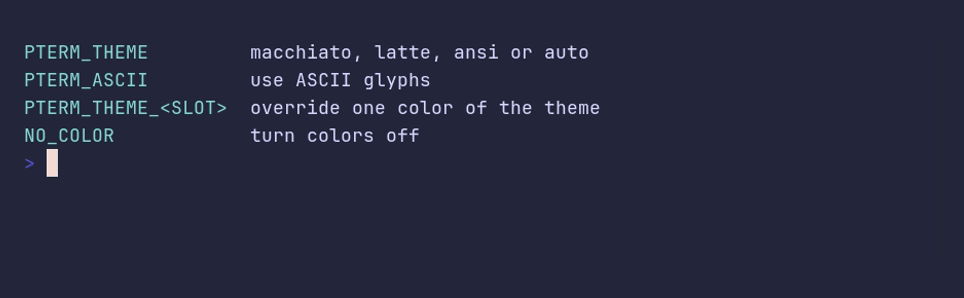

<details>

<summary>SHOW SOURCE</summary>

```go
package main

import "github.com/pterm/pterm"

func main() {
	// Without groups there is no heading and no indent, which suits short
	// reference lists such as environment variables.
	pterm.Definitions.WithDefinitions(
		pterm.Def("PTERM_THEME", "macchiato, latte, ansi or auto"),
		pterm.Def("PTERM_ASCII", "use ASCII glyphs"),
		pterm.Def("PTERM_THEME_<SLOT>", "override one color of the theme"),
		pterm.Def("NO_COLOR", "turn colors off"),
	).Render()
}
```

</details>

### demo/demo


<details>

<summary>SHOW SOURCE</summary>

```go
// The demo is the trailer at the top of the README. Every scene is a
// regular pterm call; the animations are an Area that gets redrawn with
// the next frame.
package main

import (
	"fmt"
	"io"
	"math"
	"os"
	"time"

	"golang.org/x/term"

	"github.com/pterm/pterm"
)

func main() {
	intro()
	install()
	data()
	charts()
	clean()
	outro()
}

// newScene starts a new scene on an empty screen. Piped output keeps every
// scene.
func newScene() {
	if term.IsTerminal(int(os.Stdout.Fd())) {
		fmt.Print("\x1b[H\x1b[2J")
	}
}

// frames calls draw with t running from 0 to 1 over d.
func frames(d time.Duration, draw func(t float64)) {
	const fps = 30

	n := int(d.Seconds() * fps)
	for i := range n + 1 {
		draw(float64(i) / float64(n))
		time.Sleep(time.Second / fps)
	}
}

// ease slows an animation down towards its end.
func ease(t float64) float64 { return 1 - (1-t)*(1-t)*(1-t) }

func intro() {
	area, _ := pterm.Area.WithRemoveWhenDone().Start()

	frames(3*time.Second, func(t float64) {
		logo, _ := pterm.BigText.WithText("PTerm").WithGradientOffset(t * 2).Srender()
		tagline := pterm.ToneMuted.Sprint("Beautiful terminal output in one line of Go")

		area.Update("\n" + logo + "\n\n" + tagline)
	})

	_ = area.Stop()
}

func install() {
	newScene()

	flow, _ := pterm.Flow.WithSubtitle("3 services").Start("deploy")

	step := flow.Step("Resolving dependencies")

	time.Sleep(900 * time.Millisecond)
	step.Success("Resolved 128 dependencies")

	bar, _ := pterm.Progressbar.WithTotal(40).Start("Building images")

	for range 40 {
		time.Sleep(40 * time.Millisecond)
		bar.Increment()
	}

	step = flow.Step("Running migrations")

	time.Sleep(800 * time.Millisecond)
	step.Success("Applied 4 migrations")

	pterm.Callout.Warn("Heads up").Println("billing is on an older runtime and was skipped.")

	flow.Step("Deploying billing").Skip("Skipped billing")

	step = flow.Step("Deploying api and worker")

	time.Sleep(time.Second)
	step.Success("Deployed api and worker")

	flow.Success("Live on production in 4.8s")
	time.Sleep(1500 * time.Millisecond)
}

func data() {
	newScene()
	pterm.Header.WithBadge("K8S").WithSubtitle("production").Println("Cluster status")

	rows := pterm.TableData{
		{"Pod", "Status", "CPU", "Memory", "Restarts"},
		{"api-7f9c", "running", "42%", "512 MB", "0"},
		{"api-2b1d", "running", "38%", "498 MB", "0"},
		{"worker-91aa", "running", "71%", "1.20 GB", "2"},
		{"billing-4c3e", "pending", "0%", "0 MB", "0"},
	}

	tree := pterm.TreeNode{Children: []pterm.TreeNode{
		{Text: "production", Description: "eu-central-1", Children: []pterm.TreeNode{
			{Text: "api", Description: "2 pods"},
			{Text: "worker", Description: "1 pod"},
			{Text: "billing", Description: "pending"},
		}},
		{Text: "staging", Description: "eu-west-1", Children: []pterm.TreeNode{
			{Text: "api", Description: "1 pod"},
		}},
	}}

	area, _ := pterm.Area.Start()

	// Rows and branches appear one at a time.
	for i := 2; i <= len(rows); i++ {
		table, _ := pterm.Table.WithData(rows[:i]).Srender()
		area.Update(table)
		time.Sleep(250 * time.Millisecond)
	}

	table, _ := pterm.Table.WithData(rows).Srender()

	for i := 1; i <= 6; i++ {
		t, _ := pterm.Tree.WithRoot(firstNodes(tree, i)).Srender()
		area.Update(table + "\n\n" + t)
		time.Sleep(250 * time.Millisecond)
	}

	_ = area.Stop()

	time.Sleep(1500 * time.Millisecond)
}

// firstNodes returns root with only its first n nodes, counted depth first.
func firstNodes(root pterm.TreeNode, n int) pterm.TreeNode {
	var walk func(node pterm.TreeNode) pterm.TreeNode

	walk = func(node pterm.TreeNode) pterm.TreeNode {
		out := pterm.TreeNode{Text: node.Text, Description: node.Description}

		for _, child := range node.Children {
			if n == 0 {
				break
			}

			n--

			out.Children = append(out.Children, walk(child))
		}

		return out
	}

	return walk(root)
}

func charts() {
	newScene()
	pterm.Section.WithTopPadding(0).Println("Requests per service")

	services := []string{"api", "worker", "billing", "search"}
	totals := []float64{1284, 932, 611, 287}
	cpu := []float64{12, 18, 15, 22, 30, 28, 41, 38, 52, 47, 60, 58, 71, 66, 74, 69, 80, 77, 85, 79}

	area, _ := pterm.Area.Start()

	frames(3*time.Second, func(t float64) {
		bars := make(pterm.Bars, len(services))
		for i, name := range services {
			bars[i] = pterm.Bar{Label: name, Value: math.Round(totals[i] * ease(t))}
		}

		chart, _ := pterm.BarChart.WithBars(bars).WithRange(0, 1300).Srender()

		seen := max(1, int(t*float64(len(cpu))))
		spark, _ := pterm.Sparkline.
			WithValues(cpu[:seen]...).
			WithRange(0, 100).
			WithThresholds(pterm.LoadThresholds()...).
			WithLabel("cpu").
			Srender()

		meters, _ := pterm.Meter.WithItems(
			pterm.MeterItem{Label: "cpu", Value: 0.79 * ease(t)},
			pterm.MeterItem{Label: "memory", Value: 0.64 * ease(t)},
			pterm.MeterItem{Label: "disk", Value: 0.93 * ease(t)},
		).Srender()

		area.Update(chart + "\n\n" + spark + "\n\n" + meters)
	})

	_ = area.Stop()

	time.Sleep(1500 * time.Millisecond)
}

func clean() {
	newScene()

	// The keys are scripted, so the trailer plays on its own. A real
	// program leaves out WithInput and reads the keyboard.
	keys, typist := io.Pipe()

	go func() {
		for _, key := range []string{"\x1b[B", " ", "\x1b[B", "\x1b[B", " ", "\x1b[B", " ", "\r"} {
			time.Sleep(450 * time.Millisecond)

			_, _ = typist.Write([]byte(key))
		}
	}()

	selected, _ := pterm.Multiselect.WithInput(keys).WithItems([]pterm.Option{
		{Label: "npm cache", Description: "~/.npm/_cacache", Detail: "1.2 GB", Group: "Package managers", Selected: true},
		{Label: "go build cache", Description: "~/.cache/go-build", Detail: "5.8 GB", Group: "Package managers"},
		{Label: "pip cache", Description: "~/.cache/pip", Detail: "87 MB", Group: "Package managers"},
		{Label: "Docker images", Description: "dangling and unused", Detail: "18.3 GB", Group: "Containers"},
		{Label: "Docker volumes", Description: "may hold databases", Detail: "4.7 GB", Group: "Containers", Disabled: true},
	}).Show("What should be cleaned?")

	spinner, _ := pterm.Spinner.Start(fmt.Sprintf("Cleaning %d caches", len(selected)))

	time.Sleep(1500 * time.Millisecond)
	spinner.Success("Freed 24.1 GB")

	time.Sleep(1500 * time.Millisecond)
}

func outro() {
	newScene()

	pterm.Println()
	pterm.Box.
		WithTitle("pterm").
		WithHorizontalPadding(2).
		Println(pterm.ToneAccent.Sprint("go get github.com/pterm/pterm"))
	pterm.Println()
	pterm.Success.Println("Themes, glyphs and widths adapt to every terminal")
	pterm.Info.Println("Read the docs at " + pterm.ToneInfo.Sprint("https://pterm.sh"))

	time.Sleep(3 * time.Second)
}
```

</details>

### flow/demo


<details>

<summary>SHOW SOURCE</summary>

```go
package main

import (
	"time"

	"github.com/pterm/pterm"
)

func main() {
	flow, _ := pterm.Flow.WithSubtitle("23 targets").Start("disk clean")

	step := flow.Step("Measuring what can be freed")
	time.Sleep(2 * time.Second)
	step.Success()

	// Any printer used while the flow runs is drawn on its rail.
	pterm.Callout.Warn("Heads up").Println("Up to 110 GB across 23 targets.\nDocker images are downloaded again on the next build.")

	flow.Section("Package managers")

	for _, cache := range []string{"npm", "pnpm", "go build cache"} {
		step := flow.Step("Cleaning " + cache)
		time.Sleep(700 * time.Millisecond)
		step.Success("Cleaned " + cache)
	}

	flow.Step("Docker images").Skip("Docker is not running")

	flow.Success("Freed 24.7 GB")
}
```

</details>

### flow/live-printers

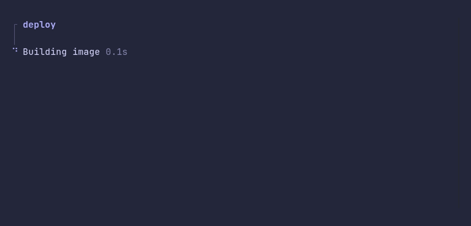

<details>

<summary>SHOW SOURCE</summary>

```go
package main

import (
	"time"

	"github.com/pterm/pterm"
)

func main() {
	flow, _ := pterm.Flow.Start("deploy")

	step := flow.Step("Building image")
	time.Sleep(time.Second)
	step.Success()

	// Any printer started while the flow runs joins its rail. A progress bar
	// animates in place and collapses into a status line when it is done.
	bar, _ := pterm.Progressbar.WithTotal(24).Start("Uploading layers")
	for range 24 {
		time.Sleep(60 * time.Millisecond)
		bar.Increment()
	}

	// Rendered output, such as a table, is indented next to the rail.
	_ = pterm.Table.WithData(pterm.TableData{
		{"Pod", "Status", "Restarts"},
		{"api-7f9c", "running", "0"},
		{"worker-2b1d", "running", "1"},
	}).Render()

	flow.Success("Deployed v2.4.1")
}
```

</details>

### flow/sections


<details>

<summary>SHOW SOURCE</summary>

```go
package main

import (
	"time"

	"github.com/pterm/pterm"
)

func main() {
	flow, _ := pterm.Flow.Start("release")

	flow.Section("Build")
	build := flow.Step("Compiling for 6 platforms")
	time.Sleep(time.Second)
	build.Success()
	flow.Log("dist/ holds 6 archives, 48 MB")

	flow.Section("Publish")
	upload := flow.Step("Uploading to GitHub")
	time.Sleep(time.Second)
	upload.Fail("GitHub returned 502")
	pterm.Error.Println("The release is a draft until the upload works")

	flow.Fail("Release incomplete")
}
```

</details>

### header/demo

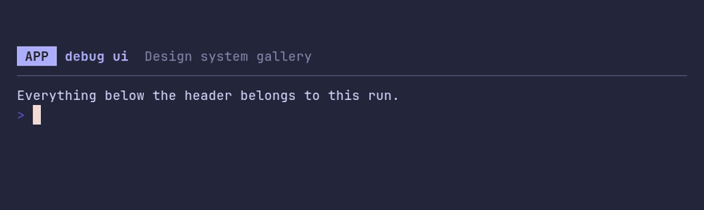

<details>

<summary>SHOW SOURCE</summary>

```go
package main

import "github.com/pterm/pterm"

func main() {
	// A header opens the output of a program: its name in a badge, what is
	// running and a short muted description, with a rule underneath.
	pterm.Header.
		WithBadge("APP").
		WithSubtitle("Design system gallery").
		Println("debug ui")

	pterm.Text.Println("Everything below the header belongs to this run.")
}
```

</details>

### header/without-badge

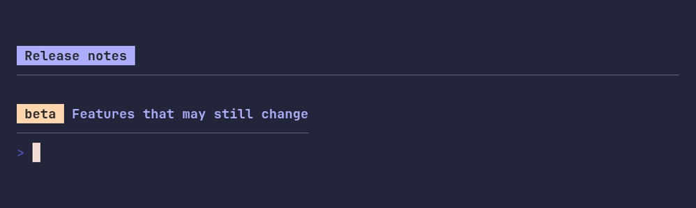

<details>

<summary>SHOW SOURCE</summary>

```go
package main

import "github.com/pterm/pterm"

func main() {
	// Without badge text, the title itself goes into the badge.
	pterm.Header.Println("Release notes")

	// The rule can match the width of the header line instead of the
	// terminal, and the badge can use any tone.
	pterm.Header.
		WithBadge("beta").
		WithBadgeTone(pterm.ToneWarning).
		WithFullWidth(false).
		Println("Features that may still change")
}
```

</details>

### heatmap/demo

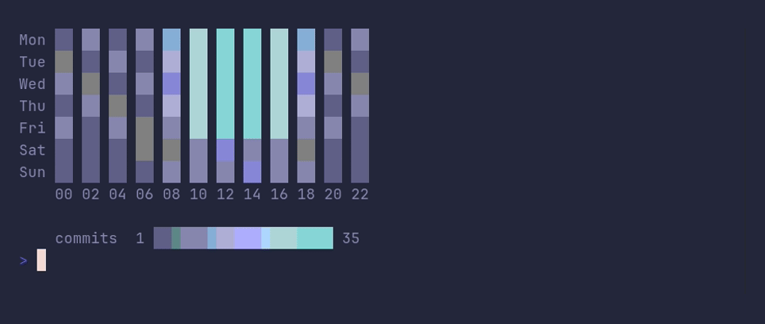

<details>

<summary>SHOW SOURCE</summary>

```go
package main

import "github.com/pterm/pterm"

func main() {
	// Commits per weekday, in two-hour slots. Each row is one day, and the
	// colors run from Border through Primary to Accent.
	data := pterm.HeatmapData{
		{3, 6, 4, 7, 12, 24, 34, 32, 28, 12, 3, 6},
		{5, 3, 6, 4, 14, 26, 31, 34, 25, 14, 5, 3},
		{7, 5, 3, 6, 11, 28, 33, 31, 27, 11, 7, 5},
		{4, 7, 5, 3, 13, 25, 35, 33, 24, 13, 4, 7},
		{6, 4, 7, 5, 10, 27, 32, 35, 26, 10, 6, 4},
		{1, 4, 2, 5, 5, 6, 11, 9, 10, 5, 1, 4},
		{3, 1, 4, 2, 7, 8, 8, 11, 7, 7, 3, 1},
	}

	// One X label per column and one Y label per row.
	axis := pterm.HeatmapAxis{
		XAxis: []string{"00", "02", "04", "06", "08", "10", "12", "14", "16", "18", "20", "22"},
		YAxis: []string{"Mon", "Tue", "Wed", "Thu", "Fri", "Sat", "Sun"},
	}

	pterm.Heatmap.WithData(data).WithAxisData(axis).WithLegendLabel("commits").Render()
}
```

</details>

### heatmap/grid


<details>

<summary>SHOW SOURCE</summary>

```go
package main

import "github.com/pterm/pterm"

func main() {
	// A correlation matrix: values from -1 to 1.
	data := pterm.HeatmapData{
		{1, 0.82, -0.4, 0.1},
		{0.82, 1, -0.25, 0.3},
		{-0.4, -0.25, 1, -0.7},
		{0.1, 0.3, -0.7, 1},
	}

	axis := pterm.HeatmapAxis{
		XAxis: []string{"cpu", "mem", "idle", "io"},
		YAxis: []string{"cpu", "mem", "idle", "io"},
	}

	// A fixed range keeps 0 in the middle of the gradient. The frame
	// implies the grid.
	pterm.Heatmap.
		WithData(data).
		WithAxisData(axis).
		WithRange(-1, 1).
		WithGradient(pterm.ToneError, pterm.ToneBorder, pterm.ToneInfo).
		WithShowValues().
		WithBoxed().
		Render()
}
```

</details>

### heatmap/values

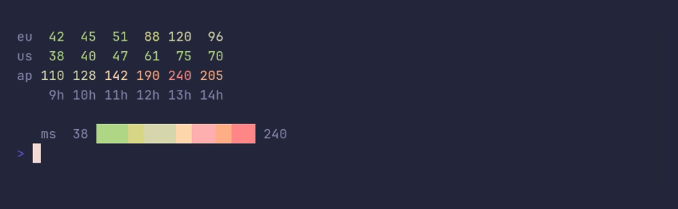

<details>

<summary>SHOW SOURCE</summary>

```go
package main

import "github.com/pterm/pterm"

func main() {
	// Response times in milliseconds per region and hour.
	data := pterm.HeatmapData{
		{42, 45, 51, 88, 120, 96},
		{38, 40, 47, 61, 75, 70},
		{110, 128, 142, 190, 240, 205},
	}

	axis := pterm.HeatmapAxis{
		XAxis: []string{"9h", "10h", "11h", "12h", "13h", "14h"},
		YAxis: []string{"eu", "us", "ap"},
	}

	// The values themselves, colored from Success to Warning to Error,
	// because high response times are bad.
	pterm.Heatmap.
		WithData(data).
		WithAxisData(axis).
		WithShowValues().
		WithGradient(pterm.TrafficTones()...).
		WithLegendLabel("ms").
		Render()
}
```

</details>

### keyhints/demo


<details>

<summary>SHOW SOURCE</summary>

```go
package main

import "github.com/pterm/pterm"

func main() {
	// Key hints tell the user which keys do what. Interactive printers
	// show them on their last line, and live views can use them too.
	pterm.KeyHints.WithHints(
		pterm.KeyHint{Key: "space", Desc: "toggle"},
		pterm.KeyHint{Key: "a", Desc: "all"},
		pterm.KeyHint{Key: "enter", Desc: "confirm"},
	).Render()

	// Entries without a key are plain information, such as a refresh rate.
	pterm.KeyHints.
		WithHint("q", "quit").
		WithHint("r", "refresh").
		WithHint("", "every 5.0s").
		Render()
}
```

</details>

### keyvalue/demo

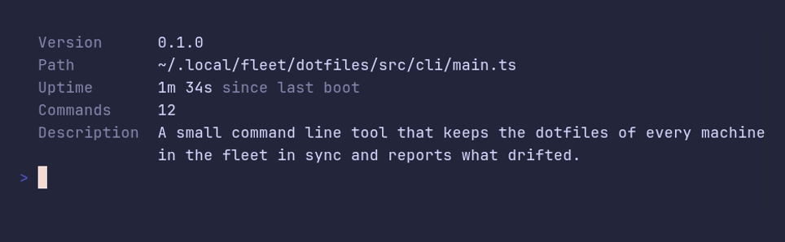

<details>

<summary>SHOW SOURCE</summary>

```go
package main

import "github.com/pterm/pterm"

func main() {
	// Keys line up and stay muted, so the values are what the eye lands on.
	// A suffix adds a muted note after a value, and long values wrap under
	// themselves instead of under the keys.
	pterm.KeyValue.WithPairs(
		pterm.KV("Version", "0.1.0"),
		pterm.KV("Path", "~/.local/fleet/dotfiles/src/cli/main.ts"),
		pterm.KV("Uptime", "1m 34s").WithSuffix("since last boot"),
		pterm.KV("Commands", 12),
		pterm.KV("Description", "A small command line tool that keeps the dotfiles of every machine in the fleet in sync and reports what drifted."),
	).Render()
}
```

</details>

### keyvalue/accent-values

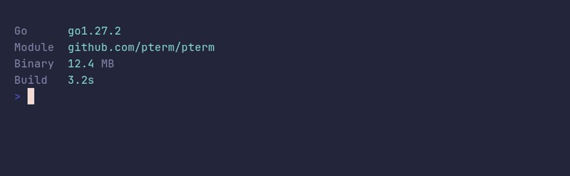

<details>

<summary>SHOW SOURCE</summary>

```go
package main

import "github.com/pterm/pterm"

func main() {
	// Accent values suit output where the values are versions, paths and
	// numbers worth noticing. Indent 0 starts the keys at the left edge.
	pterm.KeyValue.WithAccentValues().WithIndent(0).WithPairs(
		pterm.KV("Go", "go1.27.2"),
		pterm.KV("Module", "github.com/pterm/pterm"),
		pterm.KV("Binary", "12.4").WithSuffix("MB"),
		pterm.KV("Build", "3.2s"),
	).Render()
}
```

</details>

### keyvalue/from-struct

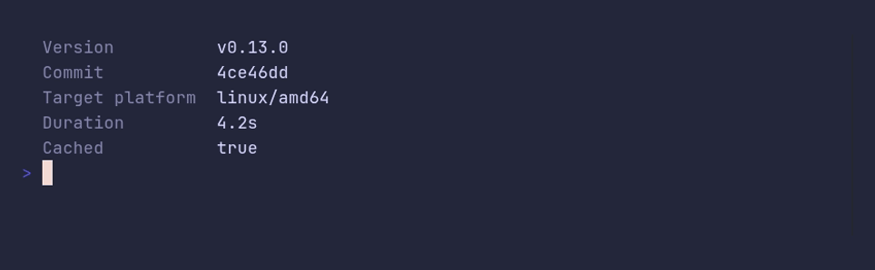

<details>

<summary>SHOW SOURCE</summary>

```go
package main

import (
	"time"

	"github.com/pterm/pterm"
	"github.com/pterm/pterm/putils"
)

type build struct {
	Version  string
	Commit   string
	Target   string `pterm:"Target platform"`
	Duration time.Duration
	Cached   bool
}

func main() {
	b := build{
		Version:  "v0.13.0",
		Commit:   "4ce46dd",
		Target:   "linux/amd64",
		Duration: 4200 * time.Millisecond,
		Cached:   true,
	}

	// Every exported field becomes a pair, in the order it is declared.
	_ = pterm.KeyValue.WithPairs(putils.KeyValueFromStruct(b)...).Render()
}
```

</details>

### logger/demo


<details>

<summary>SHOW SOURCE</summary>

```go
package main

import (
	"errors"
	"time"

	"github.com/pterm/pterm"
)

func main() {
	// The default level is Info. Trace shows every level.
	logger := pterm.Logger.WithLevel(pterm.LogLevelTrace)

	logger.Trace("Reading config", logger.Args("path", "./config.yaml"))
	logger.Debug("Config loaded", logger.ArgsFromMap(map[string]any{
		"workers": 4,
		"cache":   true,
	}))
	logger.Info("Server started", logger.Args("addr", ":8080", "env", "production"))

	time.Sleep(300 * time.Millisecond)

	logger.Warn("Slow request", logger.Args("path", "/api/search", "took", 1240*time.Millisecond))
	logger.Error("Payment failed", logger.Args("order", 1042, "error", errors.New("card declined")))

	// A line that is too long for the terminal puts its arguments on lines
	// of their own.
	logger.Info("Retrying the upload of the nightly backup to the secondary region",
		logger.Args("bucket", "s3://backups-eu-west", "attempt", 2, "reason", "connection reset by peer"))
}
```

</details>

### logger/json


<details>

<summary>SHOW SOURCE</summary>

```go
package main

import "github.com/pterm/pterm"

func main() {
	// The JSON formatter prints one object per line, for log collectors
	// that parse their input.
	logger := pterm.Logger.WithFormatter(pterm.LogFormatterJSON).WithTimeFormat("2006-01-02T15:04:05Z07:00")

	logger.Info("Server started", logger.Args("addr", ":8080", "env", "production"))
	logger.Warn("Slow request", logger.Args("path", "/api/search", "ms", 1240))
}
```

</details>

### logger/key-styles


<details>

<summary>SHOW SOURCE</summary>

```go
package main

import "github.com/pterm/pterm"

func main() {
	// Arguments are muted, except keys with a style of their own. "error"
	// and "err" are styled by default; AppendKeyStyle adds more.
	logger := pterm.Logger.AppendKeyStyle("user", pterm.ToneAccent.Style())

	logger.Info("Signed in", logger.Args("user", "ada", "method", "passkey"))
	logger.Error("Sign in failed", logger.Args("user", "grace", "error", "password expired"))
}
```

</details>

### logger/time


<details>

<summary>SHOW SOURCE</summary>

```go
package main

import (
	"time"

	"github.com/pterm/pterm"
)

func main() {
	// Lines have no time by default. WithTime adds it, muted, and
	// WithTimeFormat picks the layout.
	logger := pterm.Logger.WithTime().WithTimeFormat(time.DateTime)

	logger.Info("Job queued", logger.Args("job", "nightly-report"))
	time.Sleep(time.Second)
	logger.Info("Job finished", logger.Args("job", "nightly-report", "rows", 48213))
}
```

</details>

### logger/with-caller


<details>

<summary>SHOW SOURCE</summary>

```go
package main

import "github.com/pterm/pterm"

func main() {
	// WithCaller adds the file and line that logged, which helps to find
	// where a message comes from in a bigger program.
	logger := pterm.Logger.WithCaller()

	logger.Info("Cache warmed", logger.Args("entries", 2048))
	logger.Warn("Cache almost full", logger.Args("used", "93%"))
}
```

</details>

### meter/demo


<details>

<summary>SHOW SOURCE</summary>

```go
package main

import "github.com/pterm/pterm"

func main() {
	// A single meter: the fill, the percentage and a muted label.
	pterm.Meter.WithValue(0.34, "of the monthly budget").Render()

	pterm.Println()

	// Fills turn from Success to Warning to Error as they get full.
	pterm.Meter.WithItems(
		pterm.MeterItem{Label: "cpu", Value: 0.42},
		pterm.MeterItem{Label: "memory", Value: 0.785},
		pterm.MeterItem{Label: "disk", Value: 0.93},
		pterm.MeterItem{Label: "swap", Value: 0.06},
	).Render()
}
```

</details>

### meter/custom


<details>

<summary>SHOW SOURCE</summary>

```go
package main

import "github.com/pterm/pterm"

func main() {
	// For a meter where full is good, flip the thresholds: Error while it
	// is low, Success once it is nearly there.
	pterm.Meter.
		WithThresholds(
			pterm.Threshold{From: 0, Tone: pterm.ToneError},
			pterm.Threshold{From: 0.5, Tone: pterm.ToneWarning},
			pterm.Threshold{From: 0.8, Tone: pterm.ToneSuccess},
		).
		WithWidth(30).
		WithItems(
			pterm.MeterItem{Label: "unit tests", Value: 0.91},
			pterm.MeterItem{Label: "integration tests", Value: 0.64},
			pterm.MeterItem{Label: "docs", Value: 0.32},
		).
		Render()

	pterm.Println()

	// A fixed tone replaces the thresholds.
	pterm.Meter.WithTone(pterm.TonePrimary).WithValue(0.6, "synced").Render()
}
```

</details>

### multi/demo


<details>

<summary>SHOW SOURCE</summary>

```go
package main

import (
	"time"

	"github.com/pterm/pterm"
)

func main() {
	// Live printers stack on their own. A MultiPrinter only groups them, so
	// one Stop call ends whatever is still running.
	multi, _ := pterm.Multi.Start()

	tests, _ := pterm.Spinner.Start("Running tests")
	assets, _ := pterm.Progressbar.WithTotal(60).Start("Building assets")
	docs, _ := pterm.Progressbar.WithTotal(120).Start("Building docs")

	multi.Add(tests, assets, docs)

	for range 60 {
		time.Sleep(40 * time.Millisecond)
		assets.Increment()
		docs.Add(2)
	}

	// The bars stopped when they were full. Stop ends the spinner, and any
	// bar that was still running.
	multi.Stop()
}
```

</details>

### multiselect/demo

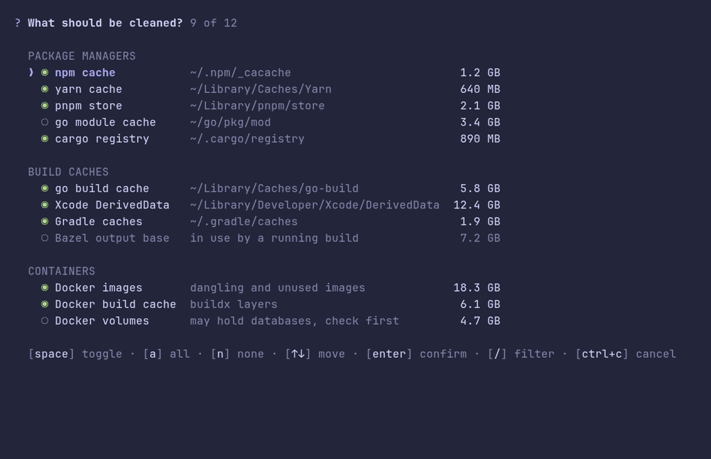

<details>

<summary>SHOW SOURCE</summary>

```go
package main

import "github.com/pterm/pterm"

func main() {
	// Groups, descriptions and right-aligned details turn a plain list into
	// a small report. Selected options start checked; disabled ones are
	// shown but cannot be toggled.
	items := []pterm.Option{
		{Group: "Package managers", Label: "npm cache", Description: "~/.npm/_cacache", Detail: "1.2 GB", Selected: true},
		{Group: "Package managers", Label: "yarn cache", Description: "~/Library/Caches/Yarn", Detail: "640 MB", Selected: true},
		{Group: "Package managers", Label: "pnpm store", Description: "~/Library/pnpm/store", Detail: "2.1 GB", Selected: true},
		{Group: "Package managers", Label: "go module cache", Description: "~/go/pkg/mod", Detail: "3.4 GB"},
		{Group: "Package managers", Label: "cargo registry", Description: "~/.cargo/registry", Detail: "890 MB", Selected: true},
		{Group: "Build caches", Label: "go build cache", Description: "~/Library/Caches/go-build", Detail: "5.8 GB", Selected: true},
		{Group: "Build caches", Label: "Xcode DerivedData", Description: "~/Library/Developer/Xcode/DerivedData", Detail: "12.4 GB", Selected: true},
		{Group: "Build caches", Label: "Gradle caches", Description: "~/.gradle/caches", Detail: "1.9 GB", Selected: true},
		{Group: "Build caches", Label: "Bazel output base", Description: "in use by a running build", Detail: "7.2 GB", Disabled: true},
		{Group: "Containers", Label: "Docker images", Description: "dangling and unused images", Detail: "18.3 GB", Selected: true},
		{Group: "Containers", Label: "Docker build cache", Description: "buildx layers", Detail: "6.1 GB", Selected: true},
		{Group: "Containers", Label: "Docker volumes", Description: "may hold databases, check first", Detail: "4.7 GB"},
	}

	cleaned, _ := pterm.Multiselect.
		WithItems(items).
		WithMaxHeight(12).
		Show("What should be cleaned?")

	pterm.Info.Printfln("Cleaning %d caches", len(cleaned))
}
```

</details>

### multiselect/custom-keys

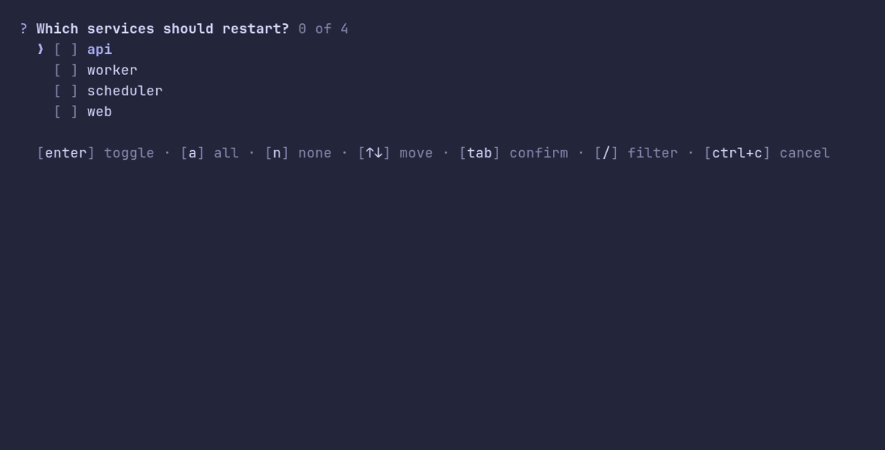

<details>

<summary>SHOW SOURCE</summary>

```go
package main

import (
	"atomicgo.dev/keyboard/keys"

	"github.com/pterm/pterm"
)

func main() {
	// Space toggles and enter confirms by default. Here enter toggles and
	// tab confirms instead, and the checkboxes are drawn in brackets. The
	// key hints at the bottom follow the keys.
	services, _ := pterm.Multiselect.
		WithOptions([]string{"api", "worker", "scheduler", "web"}).
		WithKeySelect(keys.Enter).
		WithKeyConfirm(keys.Tab).
		WithCheckmark("[x]", "[ ]").
		Show("Which services should restart?")

	pterm.Info.Printfln("Restarting %v", services)
}
```

</details>

### multiselect/options

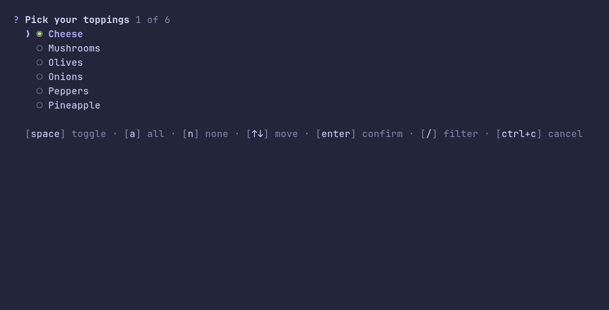

<details>

<summary>SHOW SOURCE</summary>

```go
package main

import "github.com/pterm/pterm"

func main() {
	// Plain strings work as options too. Default options start checked,
	// and are what Show returns when the program does not run in a
	// terminal.
	toppings, _ := pterm.Multiselect.
		WithOptions([]string{"Cheese", "Mushrooms", "Olives", "Onions", "Peppers", "Pineapple"}).
		WithDefaultOptions([]string{"Cheese"}).
		Show("Pick your toppings")

	pterm.Info.Printfln("Ordering a pizza with %d toppings", len(toppings))
}
```

</details>

### multiselect/show-selected-options

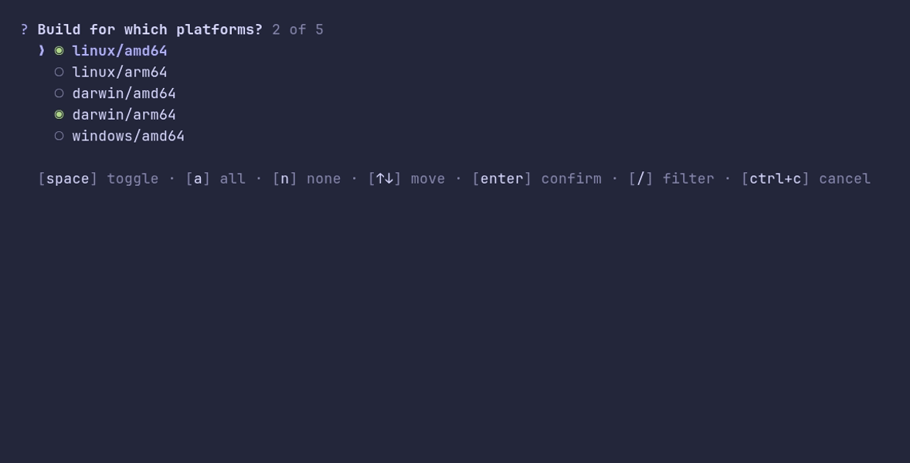

<details>

<summary>SHOW SOURCE</summary>

```go
package main

import "github.com/pterm/pterm"

func main() {
	// By default the answered prompt only counts the selection. With
	// WithShowSelectedOptions it also lists what was picked, which reads
	// well in logs and recordings.
	pterm.Multiselect.
		WithOptions([]string{"linux/amd64", "linux/arm64", "darwin/amd64", "darwin/arm64", "windows/amd64"}).
		WithDefaultOptions([]string{"linux/amd64", "darwin/arm64"}).
		WithShowSelectedOptions().
		Show("Build for which platforms?")
}
```

</details>

### panel/demo

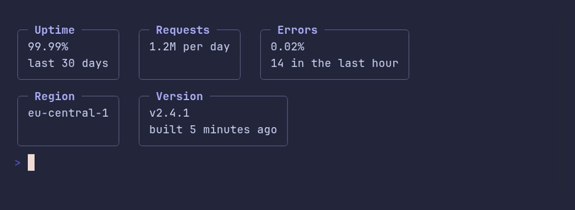

<details>

<summary>SHOW SOURCE</summary>

```go
package main

import "github.com/pterm/pterm"

func main() {
	// Boxed panels make a small dashboard. Every row is laid out side by side
	// and frames of one row end on the same line.
	pterm.Panel.WithBoxed().
		WithRow(
			pterm.PanelItem{Title: "Uptime", Data: "99.99%\nlast 30 days"},
			pterm.PanelItem{Title: "Requests", Data: "1.2M per day"},
			pterm.PanelItem{Title: "Errors", Data: "0.02%\n14 in the last hour"},
		).
		WithRow(
			pterm.PanelItem{Title: "Region", Data: "eu-central-1"},
			pterm.PanelItem{Title: "Version", Data: "v2.4.1\nbuilt 5 minutes ago"},
		).
		Render()
}
```

</details>

### panel/columns

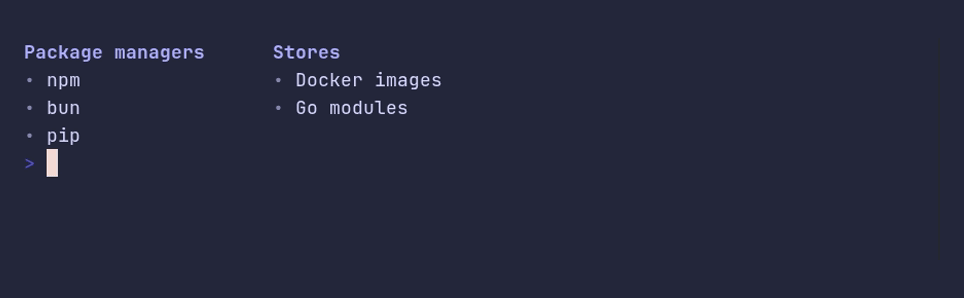

<details>

<summary>SHOW SOURCE</summary>

```go
package main

import "github.com/pterm/pterm"

func main() {
	// Without frames, panels are plain columns. Their content can come from
	// other printers, such as these bullet lists.
	tools, _ := pterm.BulletList.WithTexts("npm", "bun", "pip").Srender()
	stores, _ := pterm.BulletList.WithTexts("Docker images", "Go modules").Srender()

	pterm.Panel.WithPadding(6).WithPanels(pterm.Panels{{
		{Title: "Package managers", Data: tools},
		{Title: "Stores", Data: stores},
	}}).Render()
}
```

</details>

### panel/same-column-width


<details>

<summary>SHOW SOURCE</summary>

```go
package main

import "github.com/pterm/pterm"

func main() {
	// SameColumnWidth widens every panel to the widest one of its column,
	// so the frames of different rows line up.
	pterm.Panel.WithBoxed().WithSameColumnWidth().WithPanels(pterm.Panels{
		{
			{Title: "CPU", Data: "12%"},
			{Title: "Memory", Data: "3.1 GB of 16 GB"},
		},
		{
			{Title: "Disk", Data: "212 GB free"},
			{Title: "Network", Data: "4 MB/s"},
		},
	}).Render()
}
```

</details>

### paragraph/demo

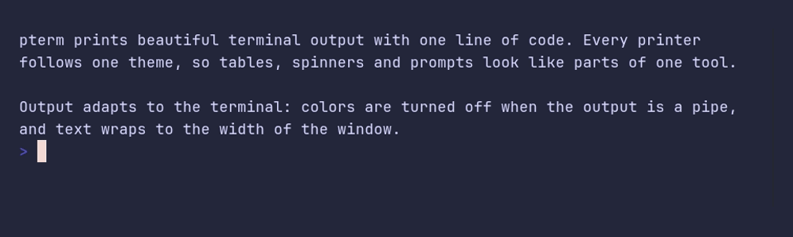

<details>

<summary>SHOW SOURCE</summary>

```go
package main

import "github.com/pterm/pterm"

func main() {
	// A paragraph wraps running text at word boundaries. Lines stay at most
	// 80 columns wide, which keeps text easy to read on wide terminals.
	// A blank line starts a new paragraph.
	pterm.Paragraph.Println(`pterm prints beautiful terminal output with one line of code. Every printer
follows one theme, so tables, spinners and prompts look like parts of one tool.

Output adapts to the terminal: colors are turned off when the output is a pipe,
and text wraps to the width of the window.`)
}
```

</details>

### paragraph/max-width


<details>

<summary>SHOW SOURCE</summary>

```go
package main

import "github.com/pterm/pterm"

func main() {
	// A narrow column suits short notes next to other output.
	pterm.Paragraph.WithMaxWidth(40).Println("The cache keeps downloaded modules for 30 days. Run the clean command to remove them earlier and free disk space.")
}
```

</details>

### prefix/demo


<details>

<summary>SHOW SOURCE</summary>

```go
package main

import "github.com/pterm/pterm"

func main() {
	pterm.Info.Println("Fetching the latest release")
	pterm.Success.Println("Deployed v1.4.2 to production")
	pterm.Warning.Println("The build cache is older than 30 days")
	pterm.Error.Println("Could not reach registry.example.com")

	// Debug output only shows up after EnableDebugMessages, for example
	// behind a --verbose flag.
	pterm.EnableDebugMessages()
	pterm.Debug.Println("Resolved 42 packages in 120ms")
}
```

</details>

### prefix/custom

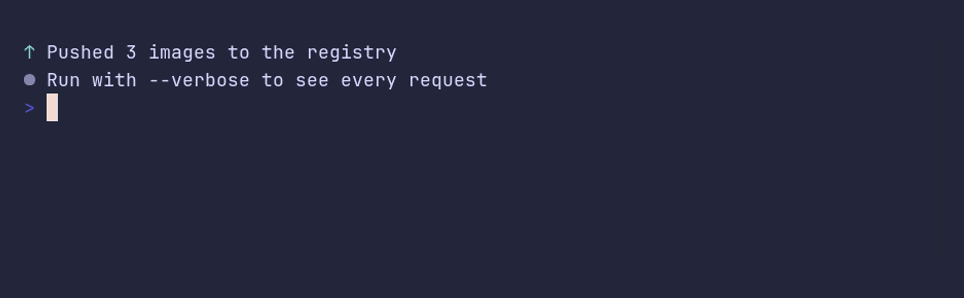

<details>

<summary>SHOW SOURCE</summary>

```go
package main

import "github.com/pterm/pterm"

func main() {
	// Status printers are values. With* returns a changed copy, so the
	// package defaults stay untouched.
	deploy := pterm.Success.WithGlyph("↑").WithTone(pterm.ToneAccent)
	deploy.Println("Pushed 3 images to the registry")

	// Store a customized printer to reuse it across the program.
	hint := pterm.Info.WithTone(pterm.ToneMuted)
	hint.Println("Run with --verbose to see every request")
}
```

</details>

### prefix/multiline

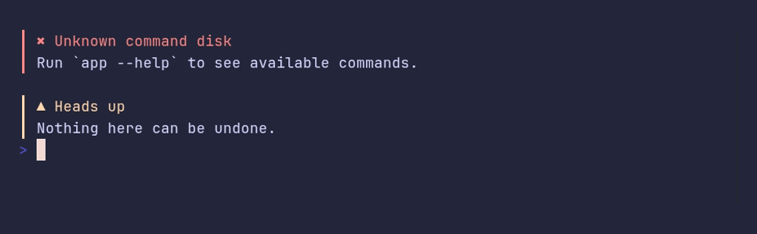

<details>

<summary>SHOW SOURCE</summary>

```go
package main

import "github.com/pterm/pterm"

func main() {
	// A message with more than one line turns into a callout. The first
	// line becomes the title.
	pterm.Error.Println("Unknown command disk\nRun `app --help` to see available commands.")

	pterm.Println()

	// WithTitle sets the title explicitly and keeps the whole message as
	// the body.
	pterm.Warning.WithTitle("Heads up").Println("Nothing here can be undone.")
}
```

</details>

### progressbar/demo

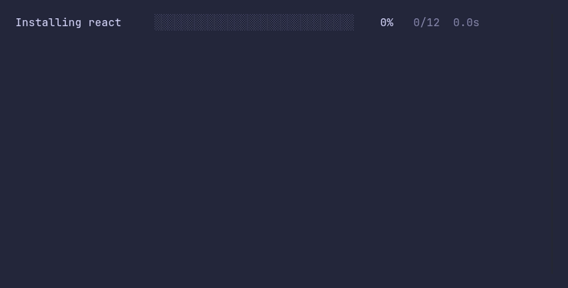

<details>

<summary>SHOW SOURCE</summary>

```go
package main

import (
	"time"

	"github.com/pterm/pterm"
)

func main() {
	packages := []string{
		"react", "react-dom", "typescript", "vite", "eslint", "prettier",
		"vitest", "zod", "date-fns", "clsx", "tailwindcss", "postcss",
	}

	bar, _ := pterm.Progressbar.WithTotal(len(packages)).Start("Installing packages")

	for i, pkg := range packages {
		bar.UpdateTitle("Installing " + pkg)

		// One package takes a while, which the ETA picks up.
		if i == 6 {
			time.Sleep(1500 * time.Millisecond)
		}

		time.Sleep(300 * time.Millisecond)

		// Output printed while the bar runs appears above it.
		pterm.Success.Println("Installed " + pkg)

		// The bar stops on its own at its total and keeps its title in the
		// status line it leaves behind, so name the result before the last
		// step.
		if i == len(packages)-1 {
			bar.UpdateTitle("Installed packages")
		}

		bar.Increment()
	}
}
```

</details>

### progressbar/cancel


<details>

<summary>SHOW SOURCE</summary>

```go
package main

import (
	"context"
	"time"

	"github.com/pterm/pterm"
)

func main() {
	// The upload takes longer than the timeout allows, so the bar ends as
	// canceled when the context runs out.
	ctx, cancel := context.WithTimeout(context.Background(), 2*time.Second)
	defer cancel()

	bar, _ := pterm.Progressbar.WithTotal(50).WithContext(ctx).Start("Uploading backup")

	// Stop after the context ended prints the canceled line before main
	// returns.
	defer bar.Stop()

	for range 50 {
		select {
		case <-ctx.Done():
			return
		case <-time.After(100 * time.Millisecond):
			bar.Increment()
		}
	}
}
```

</details>

### progressbar/custom


<details>

<summary>SHOW SOURCE</summary>

```go
package main

import (
	"time"

	"github.com/pterm/pterm"
)

func main() {
	// Every part of the bar can be changed: here a green fill, a wider bar,
	// and no ETA because the work comes in uneven chunks.
	bar, _ := pterm.Progressbar.
		WithTotal(200).
		WithTone(pterm.ToneSuccess).
		WithBarWidth(40).
		WithShowETA(false).
		Start("Migrating rows")

	for range 20 {
		time.Sleep(100 * time.Millisecond)
		bar.Add(10)
	}

	// Without title, count and timer, only the bar and the percentage are
	// left.
	bar, _ = pterm.Progressbar.
		WithShowTitle(false).
		WithShowCount(false).
		WithShowElapsedTime(false).
		WithShowETA(false).
		Start()

	for range 100 {
		time.Sleep(20 * time.Millisecond)
		bar.Increment()
	}
}
```

</details>

### progressbar/multiple


<details>

<summary>SHOW SOURCE</summary>

```go
package main

import (
	"sync"
	"time"

	"github.com/pterm/pterm"
)

func main() {
	downloads := []struct {
		name   string
		chunks int
	}{
		{"ubuntu-24.04.iso", 60},
		{"node-v22.tar.gz", 25},
		{"go1.27.zip", 40},
	}

	// Bars that run at the same time stack below each other on their own.
	var wg sync.WaitGroup

	for _, d := range downloads {
		bar, _ := pterm.Progressbar.WithTotal(d.chunks).Start(d.name)

		wg.Go(func() {
			for range d.chunks {
				time.Sleep(50 * time.Millisecond)
				bar.Increment()
			}
		})
	}

	wg.Wait()
}
```

</details>

### rule/demo


<details>

<summary>SHOW SOURCE</summary>

```go
package main

import "github.com/pterm/pterm"

func main() {
	// A rule separates parts of the output without the weight of a section
	// title. It spans the terminal.
	pterm.Text.Println("Build finished in 4.2s")
	pterm.Rule.Println()

	// The text becomes a title inside the rule.
	pterm.Rule.Println("Test results")
	pterm.Text.Println("42 passed, 0 failed")
}
```

</details>

### rule/width

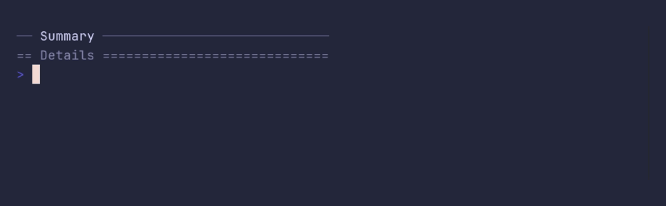

<details>

<summary>SHOW SOURCE</summary>

```go
package main

import "github.com/pterm/pterm"

func main() {
	// A fixed width lines the rule up with other output.
	pterm.Rule.WithWidth(40).Println("Summary")

	// The title can be muted, and the line can use another glyph and tone.
	pterm.Rule.
		WithWidth(40).
		WithTitleStyle(pterm.ToneMuted.Style()).
		WithGlyph("=").
		WithTone(pterm.ToneMuted).
		Println("Details")
}
```

</details>

### section/demo

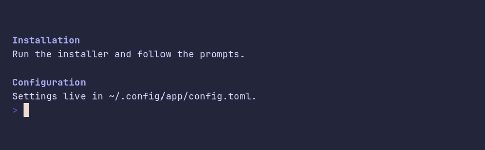

<details>

<summary>SHOW SOURCE</summary>

```go
package main

import "github.com/pterm/pterm"

func main() {
	// Sections split output into parts. Each one starts with a blank line,
	// so the program does not have to add spacing itself.
	pterm.Section.Println("Installation")
	pterm.Text.Println("Run the installer and follow the prompts.")

	pterm.Section.Println("Configuration")
	pterm.Text.Println("Settings live in ~/.config/app/config.toml.")
}
```

</details>

### section/levels

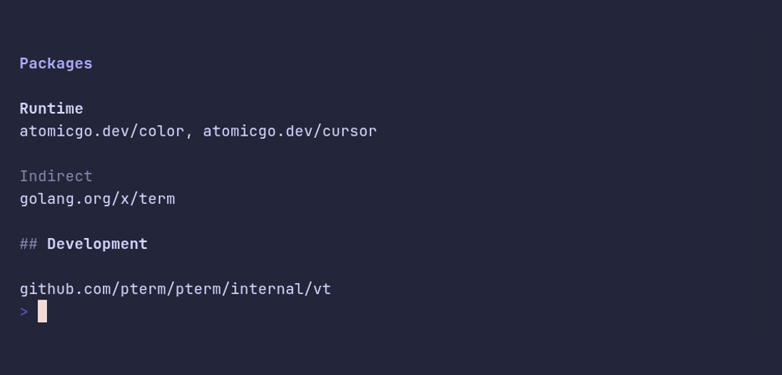

<details>

<summary>SHOW SOURCE</summary>

```go
package main

import "github.com/pterm/pterm"

func main() {
	// Deeper levels get quieter: level 2 is bold text, level 3 is muted.
	pterm.Section.Println("Packages")
	pterm.Section.WithLevel(2).Println("Runtime")
	pterm.Text.Println("atomicgo.dev/color, atomicgo.dev/cursor")
	pterm.Section.WithLevel(3).Println("Indirect")
	pterm.Text.Println("golang.org/x/term")

	// A prefix makes the depth visible, like headings in Markdown.
	pterm.Section.WithPrefix("#").WithLevel(2).WithBottomPadding(1).Println("Development")
	pterm.Text.Println("github.com/pterm/pterm/internal/vt")
}
```

</details>

### select/demo

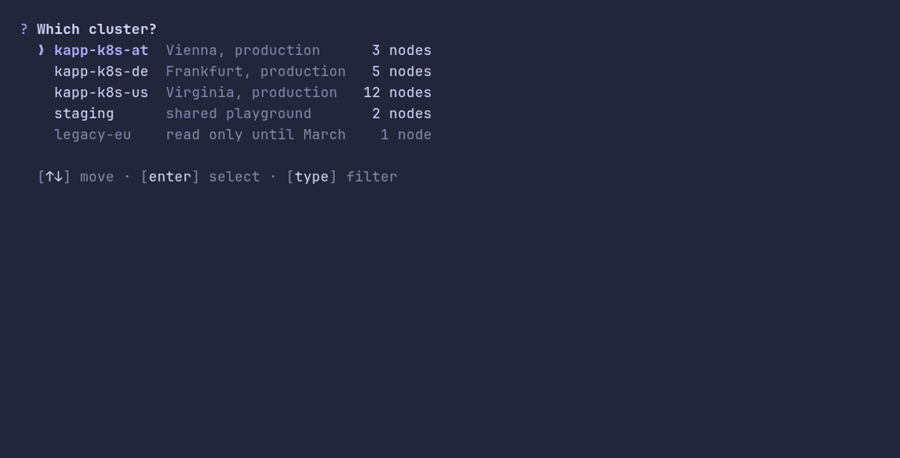

<details>

<summary>SHOW SOURCE</summary>

```go
package main

import "github.com/pterm/pterm"

func main() {
	// Options can carry a description and a right-aligned detail. Typing
	// filters the list with a fuzzy match, so "k8s us" finds kapp-k8s-us.
	// Disabled options stay visible but the cursor skips them.
	clusters := []pterm.Option{
		{Label: "kapp-k8s-at", Description: "Vienna, production", Detail: "3 nodes"},
		{Label: "kapp-k8s-de", Description: "Frankfurt, production", Detail: "5 nodes"},
		{Label: "kapp-k8s-us", Description: "Virginia, production", Detail: "12 nodes"},
		{Label: "staging", Value: "stg", Description: "shared playground", Detail: "2 nodes"},
		{Label: "legacy-eu", Description: "read only until March", Detail: "1 node", Disabled: true},
	}

	// Show returns the Value of the chosen option, or its Label when the
	// option has no Value.
	cluster, _ := pterm.Select.WithItems(clusters).Show("Which cluster?")

	pterm.Info.Printfln("Deploying to %s", cluster)
}
```

</details>

### select/long-list

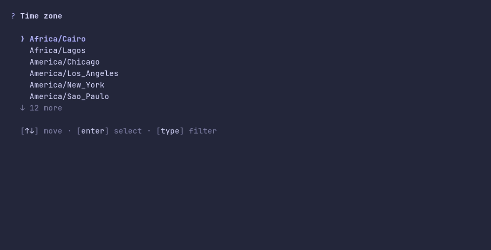

<details>

<summary>SHOW SOURCE</summary>

```go
package main

import "github.com/pterm/pterm"

func main() {
	zones := []string{
		"Africa/Cairo", "Africa/Lagos", "America/Chicago", "America/Los_Angeles",
		"America/New_York", "America/Sao_Paulo", "Asia/Dubai", "Asia/Kolkata",
		"Asia/Shanghai", "Asia/Singapore", "Asia/Tokyo", "Australia/Sydney",
		"Europe/Berlin", "Europe/London", "Europe/Paris", "Europe/Vienna",
		"Pacific/Auckland", "UTC",
	}

	// Long lists scroll and show how many options are hidden above and
	// below. Typing narrows the list down, which beats scrolling.
	zone, _ := pterm.Select.
		WithOptions(zones).
		WithMaxHeight(6).
		Show("Time zone")

	pterm.Info.Printfln("Using %s", zone)
}
```

</details>

### select/options


<details>

<summary>SHOW SOURCE</summary>

```go
package main

import "github.com/pterm/pterm"

func main() {
	// A plain list of strings is all a select needs. The default option is
	// where the cursor starts, and what Show returns without asking when
	// the program does not run in a terminal.
	language, _ := pterm.Select.
		WithOptions([]string{"Go", "Rust", "TypeScript", "Python", "Zig"}).
		WithDefaultOption("Go").
		Show("Favorite language?")

	pterm.Info.Printfln("You picked %s", language)
}
```

</details>

### slog/demo


<details>

<summary>SHOW SOURCE</summary>

```go
package main

import (
	"log/slog"

	"github.com/pterm/pterm"
)

func main() {
	// pterm's logger works as a handler for log/slog, so code that already
	// logs with slog gets the same look.
	handler := pterm.NewSlogHandler(pterm.Logger.WithLevel(pterm.LogLevelDebug))
	logger := slog.New(handler)

	logger.Debug("Connecting", "host", "db.internal", "port", 5432)
	logger.Info("Connected", "pool", 10)

	// Groups turn into dotted keys.
	requests := logger.WithGroup("request")
	requests.Warn("Slow query", "table", "orders", "ms", 830)
	requests.Error("Query failed", "table", "users", "error", "deadlock detected")
}
```

</details>

### sparkline/demo


<details>

<summary>SHOW SOURCE</summary>

```go
package main

import "github.com/pterm/pterm"

func main() {
	// One column per value, scaled between the smallest and the largest.
	pterm.Sparkline.
		WithValues(3, 5, 4, 8, 12, 9, 14, 18, 16, 21, 19, 24, 22, 17, 13, 15).
		WithLabel("requests per second").
		Render()
}
```

</details>

### sparkline/thresholds


<details>

<summary>SHOW SOURCE</summary>

```go
package main

import "github.com/pterm/pterm"

func main() {
	// Load per CPU core. A fixed range of 0 to 100 makes the thresholds
	// mean percent, and each column is toned by its own level.
	pterm.Sparkline.
		WithValues(12, 34, 88, 56, 71, 23, 95, 41, 8, 63, 77, 19, 50, 82, 30, 67).
		WithRange(0, 100).
		WithThresholds(pterm.LoadThresholds()...).
		WithLabel("16 cores").
		Render()
}
```

</details>

### spinner/demo


<details>

<summary>SHOW SOURCE</summary>

```go
package main

import (
	"time"

	"github.com/pterm/pterm"
)

func main() {
	spinner, _ := pterm.Spinner.Start("Resolving dependencies")
	time.Sleep(2 * time.Second)
	spinner.UpdateText("Downloading 42 packages")
	time.Sleep(2 * time.Second)

	// Output printed while the spinner runs appears above it.
	pterm.Info.Println("Using the module cache at ~/go/pkg/mod")
	time.Sleep(time.Second)

	spinner.Success("Installed 42 packages")
}
```

</details>

### spinner/context


<details>

<summary>SHOW SOURCE</summary>

```go
package main

import (
	"context"
	"time"

	"github.com/pterm/pterm"
)

func main() {
	// The spinner stops as canceled when the context ends, which makes
	// timeouts a one-liner.
	ctx, cancel := context.WithTimeout(context.Background(), 2*time.Second)
	defer cancel()

	spinner, _ := pterm.Spinner.WithContext(ctx).Start("Waiting for the database")

	<-ctx.Done()
	time.Sleep(100 * time.Millisecond)

	// Stopping a spinner that already ended does nothing.
	_ = spinner.Stop()
}
```

</details>

### spinner/run-with-spinner


<details>

<summary>SHOW SOURCE</summary>

```go
package main

import (
	"context"
	"errors"
	"time"

	"github.com/pterm/pterm"
	"github.com/pterm/pterm/putils"
)

func main() {
	ctx := context.Background()

	// The spinner ends as a success when the function returns nil.
	_ = putils.RunWithSpinner(ctx, "Fetching releases", func(ctx context.Context, s *pterm.SpinnerPrinter) error {
		time.Sleep(time.Second)
		s.UpdateText("Fetched 12 releases")

		return nil
	})

	// An error ends it as a failure that names the task and the error.
	err := putils.RunWithSpinner(ctx, "Uploading report", func(ctx context.Context, _ *pterm.SpinnerPrinter) error {
		time.Sleep(time.Second)
		return errors.New("the bucket does not exist")
	})
	if err != nil {
		pterm.Info.Println("Create the bucket and run the upload again.")
	}
}
```

</details>

### spinner/statuses


<details>

<summary>SHOW SOURCE</summary>

```go
package main

import (
	"time"

	"github.com/pterm/pterm"
)

func main() {
	// A spinner ends as a status line. Pick the ending that matches what
	// happened.
	s, _ := pterm.Spinner.Start("Compiling")
	time.Sleep(time.Second)
	s.Success("Compiled 18 packages")

	s, _ = pterm.Spinner.Start("Running tests")
	time.Sleep(time.Second)
	s.Warning("2 tests were skipped")

	s, _ = pterm.Spinner.Start("Uploading coverage")
	time.Sleep(time.Second)
	s.Fail("Coverage upload timed out")

	s, _ = pterm.Spinner.Start("Publishing docs")
	s.Skip("Docs are unchanged")
}
```

</details>

### style/demo

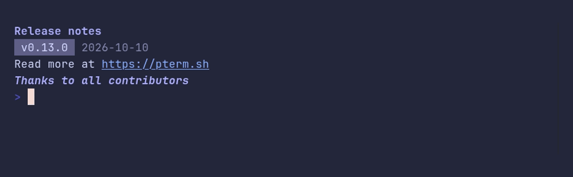

<details>

<summary>SHOW SOURCE</summary>

```go
package main

import (
	"atomicgo.dev/color"

	"github.com/pterm/pterm"
)

func main() {
	// A Style combines a foreground tone, an optional background tone and
	// text attributes. Tones follow the active theme.
	title := pterm.NewStyle(pterm.TonePrimary, color.Bold)
	label := pterm.NewStyle(pterm.ToneText).On(pterm.ToneBorder)
	link := pterm.NewStyle(pterm.ToneInfo, color.Underline)

	pterm.Println(title.Sprint("Release notes"))
	pterm.Println(label.Sprint(" v0.13.0 "), pterm.ToneMuted.Sprint("2026-10-10"))
	pterm.Println("Read more at", link.Sprint("https://pterm.sh"))

	// With adds attributes to a copy, so the base style stays untouched.
	pterm.Println(title.With(color.Italic).Sprint("Thanks to all contributors"))
}
```

</details>

### style/inline

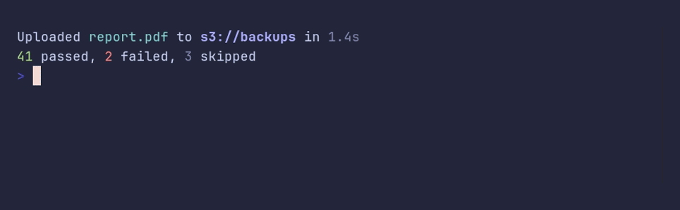

<details>

<summary>SHOW SOURCE</summary>

```go
package main

import (
	"github.com/pterm/pterm"
)

func main() {
	// Tones color single words inside your own text. They turn into plain
	// text when the output is piped or colors are disabled.
	pterm.Printfln("Uploaded %s to %s in %s",
		pterm.ToneAccent.Sprint("report.pdf"),
		pterm.TonePrimary.Bold().Sprint("s3://backups"),
		pterm.ToneMuted.Sprint("1.4s"),
	)

	pterm.Printfln("%s passed, %s failed, %s skipped",
		pterm.ToneSuccess.Sprint(41),
		pterm.ToneError.Sprint(2),
		pterm.ToneMuted.Sprint(3),
	)
}
```

</details>

### table/demo

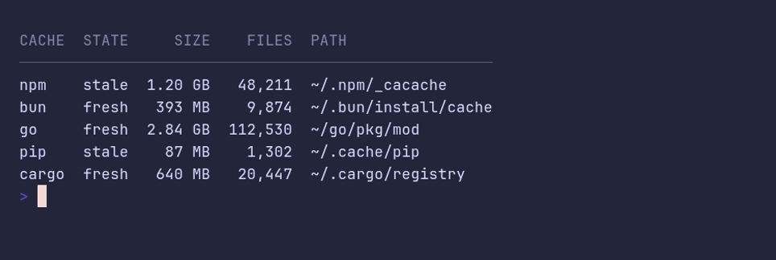

<details>

<summary>SHOW SOURCE</summary>

```go
package main

import "github.com/pterm/pterm"

func main() {
	// The first row is the header. Sizes and numbers are detected and
	// right-aligned, so the SIZE and FILES columns line up on their units.
	pterm.Table.WithData(pterm.TableData{
		{"Cache", "State", "Size", "Files", "Path"},
		{"npm", "stale", "1.20 GB", "48,211", "~/.npm/_cacache"},
		{"bun", "fresh", "393 MB", "9,874", "~/.bun/install/cache"},
		{"go", "fresh", "2.84 GB", "112,530", "~/go/pkg/mod"},
		{"pip", "stale", "87 MB", "1,302", "~/.cache/pip"},
		{"cargo", "fresh", "640 MB", "20,447", "~/.cargo/registry"},
	}).Render()
}
```

</details>

### table/alignment

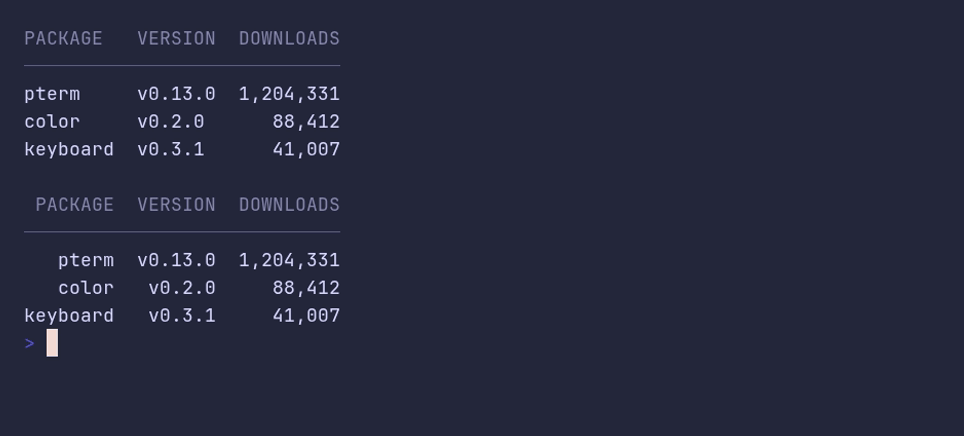

<details>

<summary>SHOW SOURCE</summary>

```go
package main

import "github.com/pterm/pterm"

func main() {
	data := pterm.TableData{
		{"Package", "Version", "Downloads"},
		{"pterm", "v0.13.0", "1,204,331"},
		{"color", "v0.2.0", "88,412"},
		{"keyboard", "v0.3.1", "41,007"},
	}

	// Numbers are right-aligned on their own. Columns can still be aligned
	// by hand, here the version column is centered.
	pterm.Table.WithData(data).WithColumnAlignment(1, pterm.AlignCenter).Render()

	pterm.Println()

	// WithRightAlignment aligns every column to the right.
	pterm.Table.WithData(data).WithRightAlignment().Render()
}
```

</details>

### table/boxed


<details>

<summary>SHOW SOURCE</summary>

```go
package main

import "github.com/pterm/pterm"

func main() {
	// A boxed table gets a rounded frame with its title inset into the top
	// edge. Use it when the table has to stand apart from the output around it.
	pterm.Table.WithBoxed().WithTitle("Services").WithData(pterm.TableData{
		{"Service", "Region", "Status", "Latency"},
		{"api", "eu-west-1", "running", "42 ms"},
		{"worker", "eu-west-1", "running", "118 ms"},
		{"billing", "us-east-1", "degraded", "1.4 s"},
	}).Render()
}
```

</details>

### table/column-min-widths

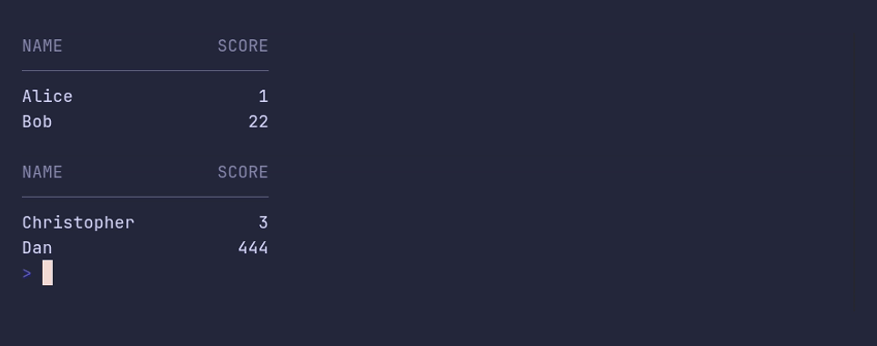

<details>

<summary>SHOW SOURCE</summary>

```go
package main

import "github.com/pterm/pterm"

func main() {
	// The same minimum widths keep two tables aligned when they are printed
	// one after another, even though their content differs in length.
	widths := []int{14, 8}

	pterm.Table.WithColumnMinWidths(widths...).WithData(pterm.TableData{
		{"Name", "Score"},
		{"Alice", "1"},
		{"Bob", "22"},
	}).Render()

	pterm.Println()

	pterm.Table.WithColumnMinWidths(widths...).WithData(pterm.TableData{
		{"Name", "Score"},
		{"Christopher", "3"},
		{"Dan", "444"},
	}).Render()
}
```

</details>

### table/from-csv


<details>

<summary>SHOW SOURCE</summary>

```go
package main

import (
	"encoding/csv"
	"strings"

	"github.com/pterm/pterm"
)

func main() {
	data := `Name,Role,Commits
Ada,maintainer,1204
Grace,reviewer,388
Linus,contributor,57`

	// WithCSVReader reads every record. The CSV header line becomes the
	// table header.
	pterm.Table.WithCSVReader(csv.NewReader(strings.NewReader(data))).Render()
}
```

</details>

### table/from-structs

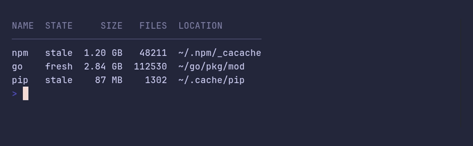

<details>

<summary>SHOW SOURCE</summary>

```go
package main

import (
	"github.com/pterm/pterm"
	"github.com/pterm/pterm/putils"
)

type cache struct {
	Name  string
	State string
	Size  string
	Files int
	Path  string `pterm:"Location"`
	inode uint64
}

func main() {
	caches := []cache{
		{Name: "npm", State: "stale", Size: "1.20 GB", Files: 48211, Path: "~/.npm/_cacache"},
		{Name: "go", State: "fresh", Size: "2.84 GB", Files: 112530, Path: "~/go/pkg/mod"},
		{Name: "pip", State: "stale", Size: "87 MB", Files: 1302, Path: "~/.cache/pip"},
	}

	// Field names become the header. A pterm tag renames a column, and
	// unexported fields are left out.
	_ = pterm.Table.WithData(putils.TableFromStructs(caches)).Render()
}
```

</details>

### table/multiple-lines


<details>

<summary>SHOW SOURCE</summary>

```go
package main

import "github.com/pterm/pterm"

func main() {
	// Cells can hold several lines. A row grows to fit its tallest cell, and
	// row separators keep the rows apart.
	pterm.Table.WithRowSeparators().WithData(pterm.TableData{
		{"Command", "Description"},
		{"init", "Create a new project\nin the current folder"},
		{"build", "Compile the project"},
		{"deploy", "Upload the build\nand restart the service\non every host"},
	}).Render()
}
```

</details>

### table/row-separators

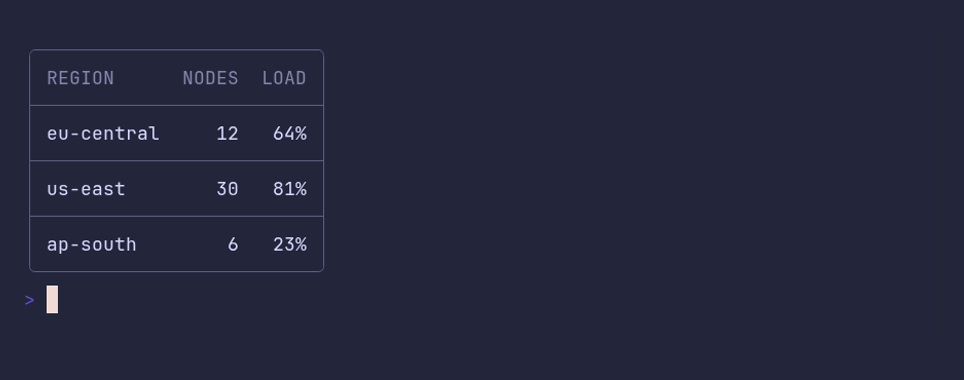

<details>

<summary>SHOW SOURCE</summary>

```go
package main

import "github.com/pterm/pterm"

func main() {
	// Row separators work in boxed tables too, where they join the frame.
	pterm.Table.WithBoxed().WithRowSeparators().WithData(pterm.TableData{
		{"Region", "Nodes", "Load"},
		{"eu-central", "12", "64%"},
		{"us-east", "30", "81%"},
		{"ap-south", "6", "23%"},
	}).Render()
}
```

</details>

### table/styles

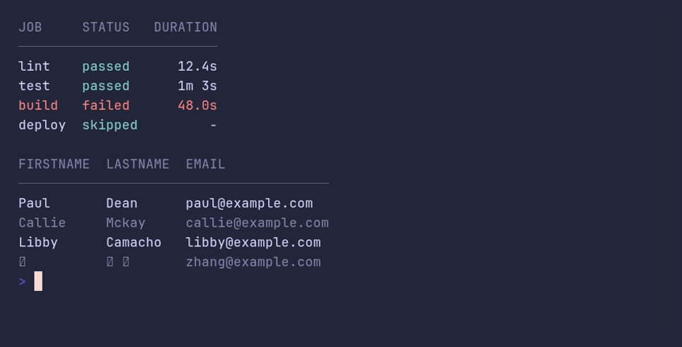

<details>

<summary>SHOW SOURCE</summary>

```go
package main

import "github.com/pterm/pterm"

func main() {
	// Styles use theme tones, so the table follows the active theme. Here the
	// status column is toned and the failed row stands out.
	pterm.Table.
		WithData(pterm.TableData{
			{"Job", "Status", "Duration"},
			{"lint", "passed", "12.4s"},
			{"test", "passed", "1m 3s"},
			{"build", "failed", "48.0s"},
			{"deploy", "skipped", "-"},
		}).
		WithColumnStyle(1, pterm.ToneAccent.Style()).
		WithRowStyle(2, pterm.ToneError.Style()).
		Render()

	pterm.Println()

	// An alternate row style makes long rows easier to follow.
	pterm.Table.
		WithData(pterm.TableData{
			{"Firstname", "Lastname", "Email"},
			{"Paul", "Dean", "paul@example.com"},
			{"Callie", "Mckay", "callie@example.com"},
			{"Libby", "Camacho", "libby@example.com"},
			{"张", "小宝", "zhang@example.com"},
		}).
		WithAlternateRowStyle(pterm.ToneMuted.Style()).
		Render()
}
```

</details>

### text/demo


<details>

<summary>SHOW SOURCE</summary>

```go
package main

import "github.com/pterm/pterm"

func main() {
	// Text prints like fmt, but in the theme's text color, and long lines
	// wrap at word boundaries to fit the terminal.
	pterm.Text.Println("Plain text follows the theme, so it matches every other printer.")
	pterm.Text.Println("Long lines wrap at the terminal width instead of being cut in the middle of a word, which keeps help texts and long messages readable in narrow windows.")
	pterm.Text.Printfln("Formatting works too: %d files, %s.", 3, "1.2 MB")
}
```

</details>

### text/styled

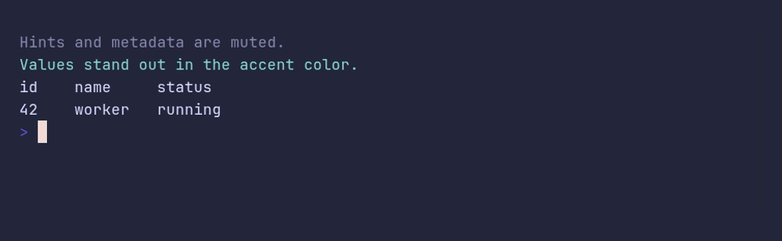

<details>

<summary>SHOW SOURCE</summary>

```go
package main

import "github.com/pterm/pterm"

func main() {
	// Any tone of the theme can be used. Keep tones for meaning: muted
	// text for hints, accent for values worth noticing.
	pterm.Text.WithTone(pterm.ToneMuted).Println("Hints and metadata are muted.")
	pterm.Text.WithTone(pterm.ToneAccent).Println("Values stand out in the accent color.")

	// WithNoWrap keeps lines exactly as they are, for preformatted output.
	pterm.Text.WithNoWrap().Println("id    name     status\n42    worker   running")
}
```

</details>

### textinput/demo


<details>

<summary>SHOW SOURCE</summary>

```go
package main

import "github.com/pterm/pterm"

func main() {
	// A single-line input. The placeholder shows what is expected and
	// disappears with the first key press; enter submits.
	name, _ := pterm.TextInput.
		WithPlaceholder("lowercase, no spaces").
		Show("Project name")

	pterm.Success.Printfln("Created %s", name)
}
```

</details>

### textinput/default-value

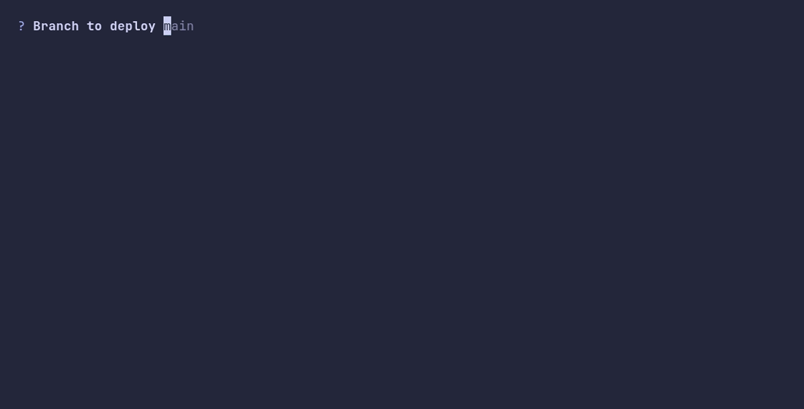

<details>

<summary>SHOW SOURCE</summary>

```go
package main

import "github.com/pterm/pterm"

func main() {
	// The default value is shown muted until the user types. Enter on an
	// empty input returns it, and tab copies it into the input to edit it.
	branch, _ := pterm.TextInput.
		WithDefaultValue("main").
		Show("Branch to deploy")

	pterm.Info.Printfln("Deploying %s", branch)
}
```

</details>

### textinput/multi-line

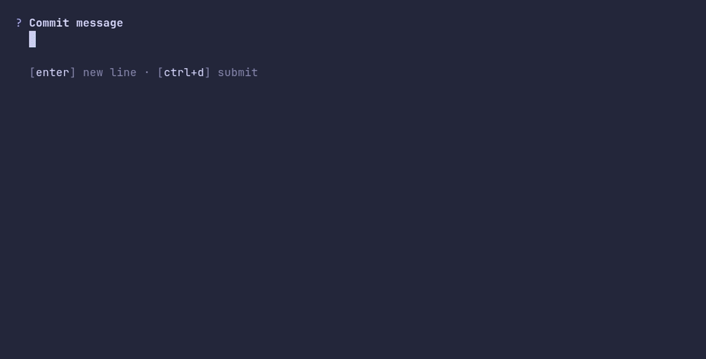

<details>

<summary>SHOW SOURCE</summary>

```go
package main

import "github.com/pterm/pterm"

func main() {
	// In multi-line mode enter starts a new line and ctrl+d submits. Long
	// lines wrap at word boundaries, and pasted text keeps its line breaks.
	message, _ := pterm.TextInput.
		WithMultiLine().
		Show("Commit message")

	pterm.Info.Printfln("Committing %d characters", len(message))
}
```

</details>

### textinput/password


<details>

<summary>SHOW SOURCE</summary>

```go
package main

import "github.com/pterm/pterm"

func main() {
	// WithMask draws every typed character as the mask. The answered
	// prompt shows a fixed number of masks, so it does not give away the
	// length of the password either.
	password, _ := pterm.TextInput.
		WithMask("*").
		Show("Password")

	pterm.Success.Printfln("Signed in with a %d character password", len(password))
}
```

</details>

### theme/demo


<details>

<summary>SHOW SOURCE</summary>

```go
package main

import (
	"fmt"

	"github.com/pterm/pterm"
)

func main() {
	// Every printer colors itself from the nine theme slots, so this list is
	// the whole palette pterm draws with.
	tones := []pterm.Tone{
		pterm.TonePrimary, pterm.ToneAccent, pterm.ToneSuccess,
		pterm.ToneWarning, pterm.ToneError, pterm.ToneInfo,
		pterm.ToneText, pterm.ToneMuted, pterm.ToneBorder,
	}

	for _, tone := range tones {
		swatch := pterm.NewStyle(pterm.ToneDefault).On(tone).Sprint("      ")
		fmt.Printf("%s %s %s\n", swatch, tone.Bold().Sprintf("%-8s", tone), pterm.ToneMuted.Sprint(tone.Color()))
	}

	fmt.Println()

	// Status messages pick their tone from the same slots.
	pterm.Success.Println("Built 12 packages")
	pterm.Info.Println("Cache is 2.3 GB")
	pterm.Warning.Println("3 dependencies are outdated")
	pterm.Error.Println("Could not reach the registry")
}
```

</details>

### theme/custom


<details>

<summary>SHOW SOURCE</summary>

```go
package main

import (
	"atomicgo.dev/color"

	"github.com/pterm/pterm"
)

func main() {
	// Start from a preset and change the slots you care about. Every printer
	// picks up the new theme, there is nothing else to restyle.
	theme := pterm.ThemeMacchiato
	theme.Primary = color.RGB(0xf5, 0xa9, 0x7f) // peach
	theme.Success = color.RGB(0x8b, 0xd5, 0xca) // teal

	pterm.SetTheme(theme)

	pterm.Success.Println("Deployed to production")
	pterm.Callout.Tip("Theme").Println("Primary is now peach and success is teal.")

	// Tones can also be fixed to a color that ignores the theme.
	pterm.Println(pterm.Fixed(color.RGB(0xc6, 0xa0, 0xf6)).Sprint("Always mauve"))
}
```

</details>

### theme/env


<details>

<summary>SHOW SOURCE</summary>

```go
package main

import (
	"github.com/pterm/pterm"
)

// Run this example with different environment variables to see the theme
// change without touching the code:
//
//	PTERM_THEME=latte go run .
//	PTERM_THEME=ansi go run .
//	PTERM_THEME_PRIMARY=#f5a97f PTERM_THEME_SUCCESS=cyan go run .
//
// PTERM_THEME defaults to "auto", which asks the terminal for its
// background color and picks Latte on light backgrounds.
func main() {
	pterm.Info.Println("Theme slots come from the environment")
	pterm.Success.Println("Tests passed")
	pterm.Warning.Println("Coverage dropped by 2%")
	pterm.Println(pterm.TonePrimary.Bold().Sprint("primary"), pterm.ToneAccent.Sprint("accent"), pterm.ToneMuted.Sprint("muted"))
}
```

</details>

### tree/demo


<details>

<summary>SHOW SOURCE</summary>

```go
package main

import "github.com/pterm/pterm"

func main() {
	// Descriptions line up in one muted column, however deep the node sits.
	pterm.Tree.WithNodes(
		pterm.TreeNode{Text: "doctor", Description: "diagnostics"},
		pterm.TreeNode{Text: "mcp", Description: "manage MCP servers", Children: []pterm.TreeNode{
			{Text: "start", Description: "boots a server"},
			{Text: "stop", Description: "stops a running server"},
		}},
		pterm.TreeNode{Text: "disk", Description: "local disk utilities", Children: []pterm.TreeNode{
			{Text: "usage", Description: "shows what takes up space"},
			{Text: "clean"},
		}},
	).Render()
}
```

</details>

### tree/from-indented


<details>

<summary>SHOW SOURCE</summary>

```go
package main

import (
	"github.com/pterm/pterm"
	"github.com/pterm/pterm/putils"
)

func main() {
	// Write the tree the way you would sketch it in a README. Each level
	// only has to be indented further than its parent.
	files := putils.TreeFromIndented(`
cmd
  pterm
    main.go
internal
  screen
    screen.go
    region.go
  text
    width.go
go.mod`)

	_ = pterm.Tree.WithRoot(files).Render()
}
```

</details>

### tree/from-leveled-list


<details>

<summary>SHOW SOURCE</summary>

```go
package main

import "github.com/pterm/pterm"

func main() {
	// A LeveledList is a flat alternative to nesting TreeNodes by hand: each
	// item states its own depth.
	list := pterm.LeveledList{
		{Level: 0, Text: "C:"},
		{Level: 1, Text: "Users"},
		{Level: 1, Text: "Windows"},
		{Level: 1, Text: "Programs"},
		{Level: 0, Text: "D:"},
		{Level: 1, Text: "Movies"},
		{Level: 1, Text: "Games"},
		{Level: 2, Text: "Shooter"},
		{Level: 3, Text: "Battlefield"},
		{Level: 0, Text: "E:"},
		{Level: 1, Text: "dev"},
		{Level: 2, Text: "pterm"},
	}

	root := list.Tree()
	root.Text = "Computer"

	pterm.Tree.WithRoot(root).Render()
}
```

</details>

### tree/root


<details>

<summary>SHOW SOURCE</summary>

```go
package main

import "github.com/pterm/pterm"

func main() {
	// The text of the root goes on the first line, above its children.
	pterm.Tree.WithRoot(pterm.TreeNode{
		Text: "pterm",
		Children: []pterm.TreeNode{
			{Text: "_examples", Children: []pterm.TreeNode{
				{Text: "table"},
				{Text: "tree"},
			}},
			{Text: "internal", Children: []pterm.TreeNode{
				{Text: "screen", Description: "the renderer"},
				{Text: "text", Description: "width, wrapping and cutting"},
			}},
			{Text: "go.mod"},
			{Text: "README.md"},
		},
	}).Render()
}
```

</details>

### tree/styled


<details>

<summary>SHOW SOURCE</summary>

```go
package main

import "github.com/pterm/pterm"

func main() {
	// Every part has its own tone. Here the node names are Accent and the
	// branches get one more column of line per level.
	pterm.Tree.
		WithTextStyle(pterm.ToneAccent.Style()).
		WithLineTone(pterm.ToneMuted).
		WithIndent(1).
		WithNodes(
			pterm.TreeNode{Text: "cmd", Children: []pterm.TreeNode{
				{Text: "main.go"},
			}},
			pterm.TreeNode{Text: "internal", Children: []pterm.TreeNode{
				{Text: "server.go"},
				{Text: "config.go"},
			}},
			pterm.TreeNode{Text: "go.mod"},
		).
		Render()
}
```

</details>

<!-- examples:end -->


---

> GitHub [@pterm](https://github.com/pterm) &nbsp;&middot;&nbsp;
> Author [@MarvinJWendt](https://github.com/MarvinJWendt)
> ([mjw.dev](https://mjw.dev))
> | [PTerm.sh](https://pterm.sh)


