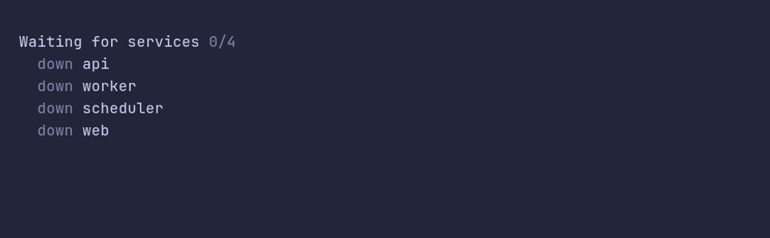

### area/demo



<details>

<summary>SHOW SOURCE</summary>

```go
package main

import (
	"fmt"
	"strings"
	"time"

	"github.com/pterm/pterm"
)

func main() {
	services := []string{"api", "worker", "scheduler", "web"}
	healthy := 0

	// An area redraws any text in place. Here it shows a small health board
	// that updates as services come up.
	area, _ := pterm.Area.Start(board(services, healthy))

	for healthy < len(services) {
		time.Sleep(700 * time.Millisecond)

		healthy++
		area.Update(board(services, healthy))
	}

	// The last content stays on screen.
	area.Stop()
}

// board renders one line per service, with the first n marked as healthy.
func board(services []string, n int) string {
	var b strings.Builder

	fmt.Fprintf(&b, "Waiting for services %s\n", pterm.ToneMuted.Sprintf("%d/%d", n, len(services)))

	for i, s := range services {
		if i < n {
			b.WriteString("  " + pterm.ToneSuccess.Sprint("up  ") + " " + s + "\n")
		} else {
			b.WriteString("  " + pterm.ToneMuted.Sprint("down") + " " + s + "\n")
		}
	}

	return b.String()
}
```

</details>

### area/fullscreen-center


<details>

<summary>SHOW SOURCE</summary>

```go
package main

import (
	"time"

	"github.com/pterm/pterm"
)

func main() {
	// Fullscreen fills the terminal height and Center puts the content in
	// the middle of it, which suits a countdown or a splash screen.
	area, _ := pterm.Area.WithFullscreen().WithCenter().WithRemoveWhenDone().Start()

	for i := 5; i > 0; i-- {
		area.Update(pterm.TonePrimary.Bold().Sprintf("Launching in %d", i))
		time.Sleep(time.Second)
	}

	area.Stop()
	pterm.Success.Println("Launched")
}
```

</details>

