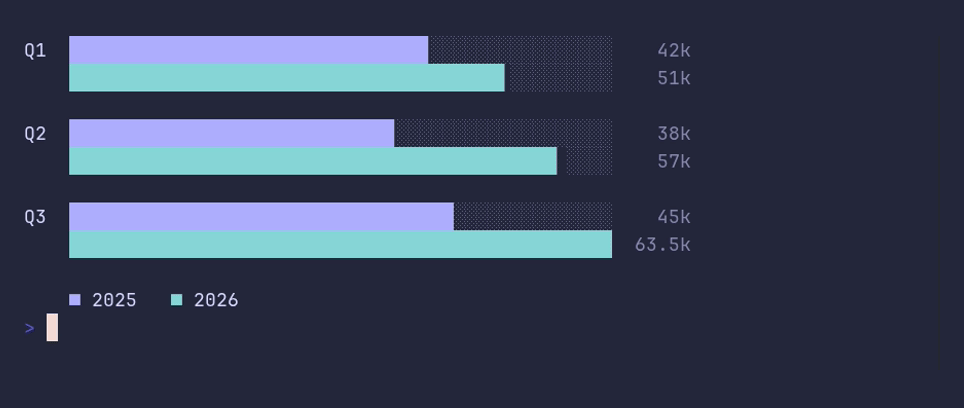

# barchart/grouped



```go
package main

import "github.com/pterm/pterm"

func main() {
	// Each group holds one value per series, in the order of WithSeries.
	// The series names make up the legend under the chart.
	pterm.BarChart.
		WithSeries("2025", "2026").
		WithGroups(pterm.BarGroups{
			{Label: "Q1", Values: []float64{42, 51}},
			{Label: "Q2", Values: []float64{38, 57}},
			{Label: "Q3", Values: []float64{45, 63.5}},
		}).
		WithUnit("k").
		Render()
}
```
