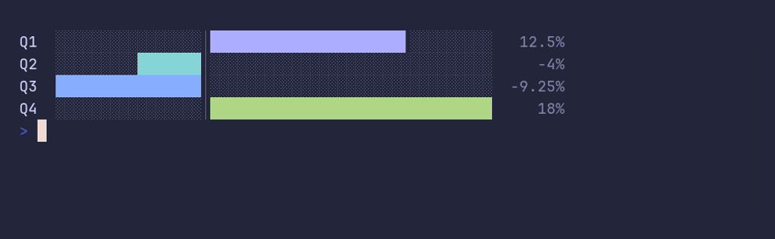

# barchart/negative



```go
package main

import "github.com/pterm/pterm"

func main() {
	// Losses grow to the left of the zero axis, gains to the right.
	pterm.BarChart.WithBars(pterm.Bars{
		{Label: "Q1", Value: 12.5},
		{Label: "Q2", Value: -4},
		{Label: "Q3", Value: -9.25},
		{Label: "Q4", Value: 18},
	}).WithUnit("%").Render()
}
```
