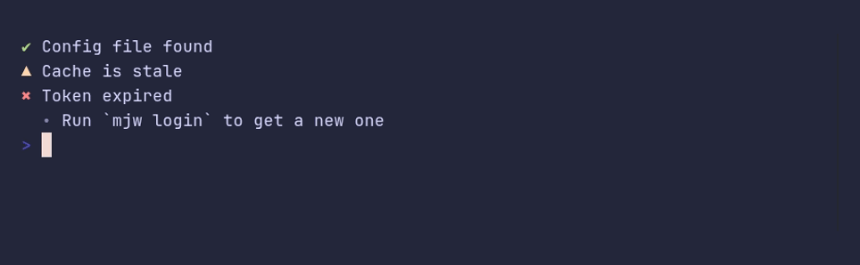
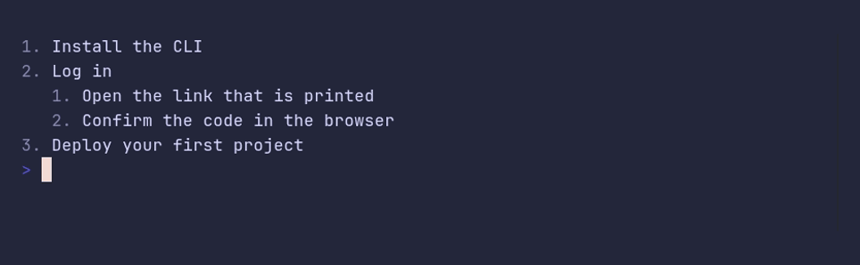

### bulletlist/demo


<details>

<summary>SHOW SOURCE</summary>

```go
package main

import "github.com/pterm/pterm"

func main() {
	// Level nests an item under the one before it. Long items wrap under
	// their own text, not under the bullet.
	pterm.BulletList.WithItems([]pterm.BulletListItem{
		{Text: "Measure what can be freed"},
		{Level: 1, Text: "npm, bun and pip caches"},
		{Level: 1, Text: "Docker images that no container uses"},
		{Text: "Ask before deleting anything"},
		{Text: "Clean up and print a summary of how much space came back, grouped by tool"},
	}).Render()
}
```

</details>

### bulletlist/custom-bullets



<details>

<summary>SHOW SOURCE</summary>

```go
package main

import "github.com/pterm/pterm"

func main() {
	glyphs := pterm.CurrentGlyphs()

	// Items can bring their own bullet and tone, which turns a list into a
	// small checklist. Glyphs come from the glyph set, so they fall back to
	// ASCII on terminals without Unicode.
	pterm.BulletList.WithItems([]pterm.BulletListItem{
		{Text: "Config file found", Bullet: glyphs.Success, Tone: pterm.ToneSuccess},
		{Text: "Cache is stale", Bullet: glyphs.Warning, Tone: pterm.ToneWarning},
		{Text: "Token expired", Bullet: glyphs.Error, Tone: pterm.ToneError},
		{Level: 1, Text: "Run `mjw login` to get a new one"},
	}).Render()
}
```

</details>

### bulletlist/ordered



<details>

<summary>SHOW SOURCE</summary>

```go
package main

import "github.com/pterm/pterm"

func main() {
	// An ordered list numbers its items. Every level counts on its own and
	// starts again under each parent.
	pterm.BulletList.WithOrdered().WithItems([]pterm.BulletListItem{
		{Text: "Install the CLI"},
		{Text: "Log in"},
		{Level: 1, Text: "Open the link that is printed"},
		{Level: 1, Text: "Confirm the code in the browser"},
		{Text: "Deploy your first project"},
	}).Render()
}
```

</details>

