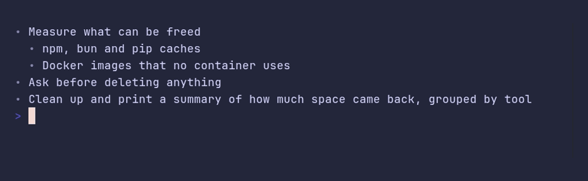

# bulletlist/demo



```go
package main

import "github.com/pterm/pterm"

func main() {
	// Level nests an item under the one before it. Long items wrap under
	// their own text, not under the bullet.
	pterm.BulletList.WithItems([]pterm.BulletListItem{
		{Text: "Measure what can be freed"},
		{Level: 1, Text: "npm, bun and pip caches"},
		{Level: 1, Text: "Docker images that no container uses"},
		{Text: "Ask before deleting anything"},
		{Text: "Clean up and print a summary of how much space came back, grouped by tool"},
	}).Render()
}
```
