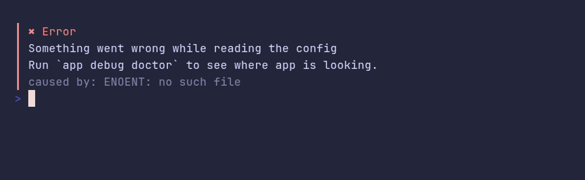

# callout/hint



```go
package main

import "github.com/pterm/pterm"

func main() {
	// A hint is a muted last line, good for the cause of an error or a
	// next step.
	pterm.Callout.Danger("Error").
		WithHint("caused by: ENOENT: no such file").
		Println("Something went wrong while reading the config\nRun `app debug doctor` to see where app is looking.")
}
```
