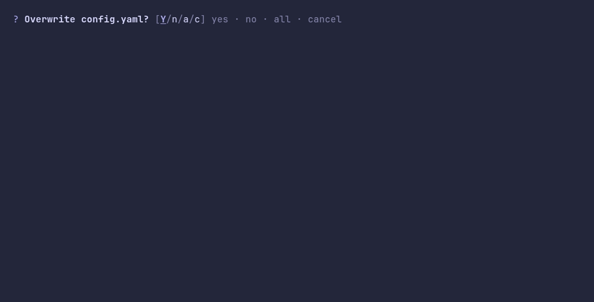
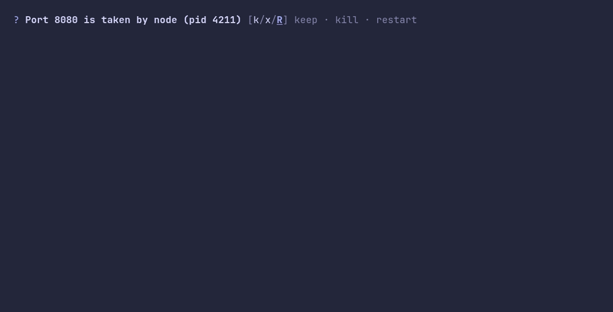

### continue/demo



<details>

<summary>SHOW SOURCE</summary>

```go
package main

import "github.com/pterm/pterm"

func main() {
	files := []string{"config.yaml", "docker-compose.yml", ".env"}
	overwriteAll := false

	for _, file := range files {
		if overwriteAll {
			pterm.Success.Printfln("Overwrote %s", file)
			continue
		}

		// Typing the first letter of an answer picks it, enter takes the
		// default. "all" lets the loop skip the remaining questions.
		answer, _ := pterm.Continue.Show("Overwrite " + file + "?")

		switch answer {
		case "yes":
			pterm.Success.Printfln("Overwrote %s", file)
		case "all":
			overwriteAll = true

			pterm.Success.Printfln("Overwrote %s", file)
		case "cancel":
			return
		}
	}
}
```

</details>

### continue/custom-options



<details>

<summary>SHOW SOURCE</summary>

```go
package main

import "github.com/pterm/pterm"

func main() {
	// Options and their handles can be anything. Handles default to the
	// first letter of each option; here "keep" and "kill" would clash, so
	// they get their own.
	answer, _ := pterm.Continue.
		WithOptions([]string{"keep", "kill", "restart"}).
		WithHandles([]string{"k", "x", "r"}).
		WithDefaultValue("restart").
		Show("Port 8080 is taken by node (pid 4211)")

	pterm.Info.Printfln("You chose to %s it", answer)
}
```

</details>

