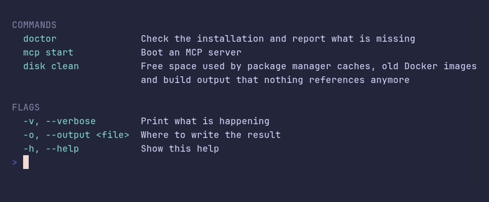

# definitions/demo



```go
package main

import "github.com/pterm/pterm"

func main() {
	// Groups get an uppercase, muted heading. The term column is shared by
	// all groups, so every description starts in the same column.
	pterm.Definitions.
		WithGroup("Commands",
			pterm.Def("doctor", "Check the installation and report what is missing"),
			pterm.Def("mcp start", "Boot an MCP server"),
			pterm.Def("disk clean", "Free space used by package manager caches, old Docker images and build output that nothing references anymore"),
		).
		WithGroup("Flags",
			pterm.Def("-v, --verbose", "Print what is happening"),
			pterm.Def("-o, --output <file>", "Where to write the result"),
			pterm.Def("-h, --help", "Show this help"),
		).
		Render()
}
```
