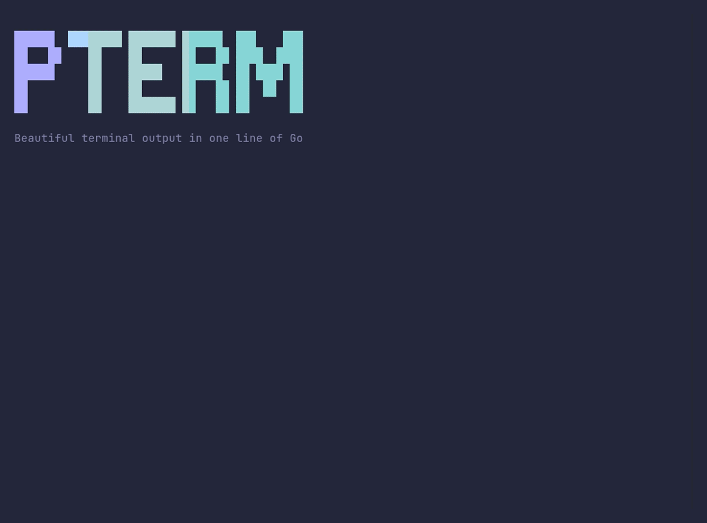

# demo/demo



```go
// The demo is the trailer at the top of the README. Every scene is a
// regular pterm call; the animations are an Area that gets redrawn with
// the next frame.
package main

import (
	"fmt"
	"io"
	"math"
	"os"
	"time"

	"golang.org/x/term"

	"github.com/pterm/pterm"
)

func main() {
	intro()
	install()
	data()
	charts()
	clean()
	outro()
}

// newScene starts a new scene on an empty screen. Piped output keeps every
// scene.
func newScene() {
	if term.IsTerminal(int(os.Stdout.Fd())) {
		fmt.Print("\x1b[H\x1b[2J")
	}
}

// frames calls draw with t running from 0 to 1 over d.
func frames(d time.Duration, draw func(t float64)) {
	const fps = 30

	n := int(d.Seconds() * fps)
	for i := range n + 1 {
		draw(float64(i) / float64(n))
		time.Sleep(time.Second / fps)
	}
}

// ease slows an animation down towards its end.
func ease(t float64) float64 { return 1 - (1-t)*(1-t)*(1-t) }

func intro() {
	area, _ := pterm.Area.WithRemoveWhenDone().Start()

	frames(3*time.Second, func(t float64) {
		logo, _ := pterm.BigText.WithText("PTerm").WithGradientOffset(t * 2).Srender()
		tagline := pterm.ToneMuted.Sprint("Beautiful terminal output in one line of Go")

		area.Update("\n" + logo + "\n\n" + tagline)
	})

	_ = area.Stop()
}

func install() {
	newScene()

	flow, _ := pterm.Flow.WithSubtitle("3 services").Start("deploy")

	step := flow.Step("Resolving dependencies")

	time.Sleep(900 * time.Millisecond)
	step.Success("Resolved 128 dependencies")

	bar, _ := pterm.Progressbar.WithTotal(40).Start("Building images")

	for range 40 {
		time.Sleep(40 * time.Millisecond)
		bar.Increment()
	}

	step = flow.Step("Running migrations")

	time.Sleep(800 * time.Millisecond)
	step.Success("Applied 4 migrations")

	pterm.Callout.Warn("Heads up").Println("billing is on an older runtime and was skipped.")

	flow.Step("Deploying billing").Skip("Skipped billing")

	step = flow.Step("Deploying api and worker")

	time.Sleep(time.Second)
	step.Success("Deployed api and worker")

	flow.Success("Live on production in 4.8s")
	time.Sleep(1500 * time.Millisecond)
}

func data() {
	newScene()
	pterm.Header.WithBadge("K8S").WithSubtitle("production").Println("Cluster status")

	rows := pterm.TableData{
		{"Pod", "Status", "CPU", "Memory", "Restarts"},
		{"api-7f9c", "running", "42%", "512 MB", "0"},
		{"api-2b1d", "running", "38%", "498 MB", "0"},
		{"worker-91aa", "running", "71%", "1.20 GB", "2"},
		{"billing-4c3e", "pending", "0%", "0 MB", "0"},
	}

	tree := pterm.TreeNode{Children: []pterm.TreeNode{
		{Text: "production", Description: "eu-central-1", Children: []pterm.TreeNode{
			{Text: "api", Description: "2 pods"},
			{Text: "worker", Description: "1 pod"},
			{Text: "billing", Description: "pending"},
		}},
		{Text: "staging", Description: "eu-west-1", Children: []pterm.TreeNode{
			{Text: "api", Description: "1 pod"},
		}},
	}}

	area, _ := pterm.Area.Start()

	// Rows and branches appear one at a time.
	for i := 2; i <= len(rows); i++ {
		table, _ := pterm.Table.WithData(rows[:i]).Srender()
		area.Update(table)
		time.Sleep(250 * time.Millisecond)
	}

	table, _ := pterm.Table.WithData(rows).Srender()

	for i := 1; i <= 6; i++ {
		t, _ := pterm.Tree.WithRoot(firstNodes(tree, i)).Srender()
		area.Update(table + "\n\n" + t)
		time.Sleep(250 * time.Millisecond)
	}

	_ = area.Stop()

	time.Sleep(1500 * time.Millisecond)
}

// firstNodes returns root with only its first n nodes, counted depth first.
func firstNodes(root pterm.TreeNode, n int) pterm.TreeNode {
	var walk func(node pterm.TreeNode) pterm.TreeNode

	walk = func(node pterm.TreeNode) pterm.TreeNode {
		out := pterm.TreeNode{Text: node.Text, Description: node.Description}

		for _, child := range node.Children {
			if n == 0 {
				break
			}

			n--

			out.Children = append(out.Children, walk(child))
		}

		return out
	}

	return walk(root)
}

func charts() {
	newScene()
	pterm.Section.WithTopPadding(0).Println("Requests per service")

	services := []string{"api", "worker", "billing", "search"}
	totals := []float64{1284, 932, 611, 287}
	cpu := []float64{12, 18, 15, 22, 30, 28, 41, 38, 52, 47, 60, 58, 71, 66, 74, 69, 80, 77, 85, 79}

	area, _ := pterm.Area.Start()

	frames(3*time.Second, func(t float64) {
		bars := make(pterm.Bars, len(services))
		for i, name := range services {
			bars[i] = pterm.Bar{Label: name, Value: math.Round(totals[i] * ease(t))}
		}

		chart, _ := pterm.BarChart.WithBars(bars).WithRange(0, 1300).Srender()

		seen := max(1, int(t*float64(len(cpu))))
		spark, _ := pterm.Sparkline.
			WithValues(cpu[:seen]...).
			WithRange(0, 100).
			WithThresholds(pterm.LoadThresholds()...).
			WithLabel("cpu").
			Srender()

		meters, _ := pterm.Meter.WithItems(
			pterm.MeterItem{Label: "cpu", Value: 0.79 * ease(t)},
			pterm.MeterItem{Label: "memory", Value: 0.64 * ease(t)},
			pterm.MeterItem{Label: "disk", Value: 0.93 * ease(t)},
		).Srender()

		area.Update(chart + "\n\n" + spark + "\n\n" + meters)
	})

	_ = area.Stop()

	time.Sleep(1500 * time.Millisecond)
}

func clean() {
	newScene()

	// The keys are scripted, so the trailer plays on its own. A real
	// program leaves out WithInput and reads the keyboard.
	keys, typist := io.Pipe()

	go func() {
		for _, key := range []string{"\x1b[B", " ", "\x1b[B", "\x1b[B", " ", "\x1b[B", " ", "\r"} {
			time.Sleep(450 * time.Millisecond)

			_, _ = typist.Write([]byte(key))
		}
	}()

	selected, _ := pterm.Multiselect.WithInput(keys).WithItems([]pterm.Option{
		{Label: "npm cache", Description: "~/.npm/_cacache", Detail: "1.2 GB", Group: "Package managers", Selected: true},
		{Label: "go build cache", Description: "~/.cache/go-build", Detail: "5.8 GB", Group: "Package managers"},
		{Label: "pip cache", Description: "~/.cache/pip", Detail: "87 MB", Group: "Package managers"},
		{Label: "Docker images", Description: "dangling and unused", Detail: "18.3 GB", Group: "Containers"},
		{Label: "Docker volumes", Description: "may hold databases", Detail: "4.7 GB", Group: "Containers", Disabled: true},
	}).Show("What should be cleaned?")

	spinner, _ := pterm.Spinner.Start(fmt.Sprintf("Cleaning %d caches", len(selected)))

	time.Sleep(1500 * time.Millisecond)
	spinner.Success("Freed 24.1 GB")

	time.Sleep(1500 * time.Millisecond)
}

func outro() {
	newScene()

	pterm.Println()
	pterm.Box.
		WithTitle("pterm").
		WithHorizontalPadding(2).
		Println(pterm.ToneAccent.Sprint("go get github.com/pterm/pterm"))
	pterm.Println()
	pterm.Success.Println("Themes, glyphs and widths adapt to every terminal")
	pterm.Info.Println("Read the docs at " + pterm.ToneInfo.Sprint("https://pterm.sh"))

	time.Sleep(3 * time.Second)
}
```
