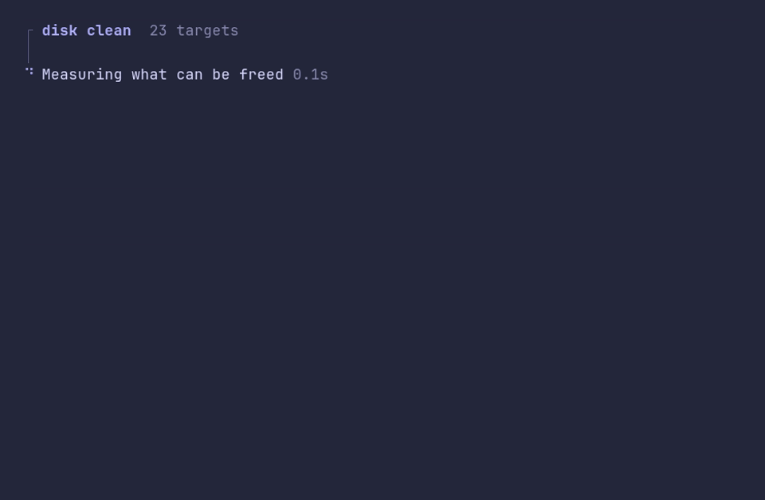

# flow/demo



```go
package main

import (
	"time"

	"github.com/pterm/pterm"
)

func main() {
	flow, _ := pterm.Flow.WithSubtitle("23 targets").Start("disk clean")

	step := flow.Step("Measuring what can be freed")
	time.Sleep(2 * time.Second)
	step.Success()

	// Any printer used while the flow runs is drawn on its rail.
	pterm.Callout.Warn("Heads up").Println("Up to 110 GB across 23 targets.\nDocker images are downloaded again on the next build.")

	flow.Section("Package managers")

	for _, cache := range []string{"npm", "pnpm", "go build cache"} {
		step := flow.Step("Cleaning " + cache)
		time.Sleep(700 * time.Millisecond)
		step.Success("Cleaned " + cache)
	}

	flow.Step("Docker images").Skip("Docker is not running")

	flow.Success("Freed 24.7 GB")
}
```
