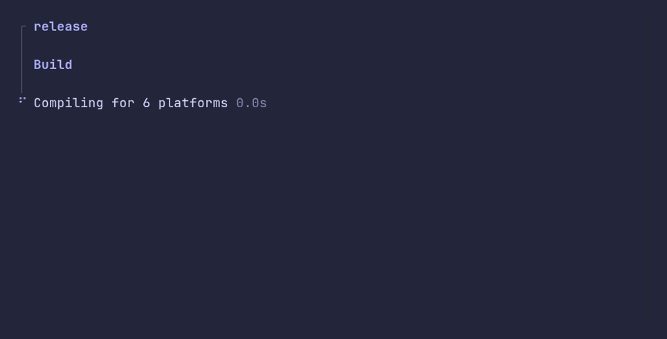

# flow/sections



```go
package main

import (
	"time"

	"github.com/pterm/pterm"
)

func main() {
	flow, _ := pterm.Flow.Start("release")

	flow.Section("Build")
	build := flow.Step("Compiling for 6 platforms")
	time.Sleep(time.Second)
	build.Success()
	flow.Log("dist/ holds 6 archives, 48 MB")

	flow.Section("Publish")
	upload := flow.Step("Uploading to GitHub")
	time.Sleep(time.Second)
	upload.Fail("GitHub returned 502")
	pterm.Error.Println("The release is a draft until the upload works")

	flow.Fail("Release incomplete")
}
```
