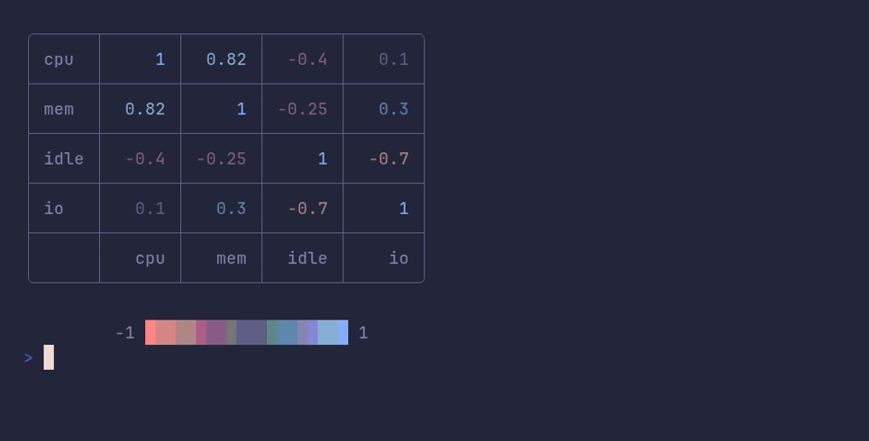

# heatmap/grid



```go
package main

import "github.com/pterm/pterm"

func main() {
	// A correlation matrix: values from -1 to 1.
	data := pterm.HeatmapData{
		{1, 0.82, -0.4, 0.1},
		{0.82, 1, -0.25, 0.3},
		{-0.4, -0.25, 1, -0.7},
		{0.1, 0.3, -0.7, 1},
	}

	axis := pterm.HeatmapAxis{
		XAxis: []string{"cpu", "mem", "idle", "io"},
		YAxis: []string{"cpu", "mem", "idle", "io"},
	}

	// A fixed range keeps 0 in the middle of the gradient. The frame
	// implies the grid.
	pterm.Heatmap.
		WithData(data).
		WithAxisData(axis).
		WithRange(-1, 1).
		WithGradient(pterm.ToneError, pterm.ToneBorder, pterm.ToneInfo).
		WithShowValues().
		WithBoxed().
		Render()
}
```
