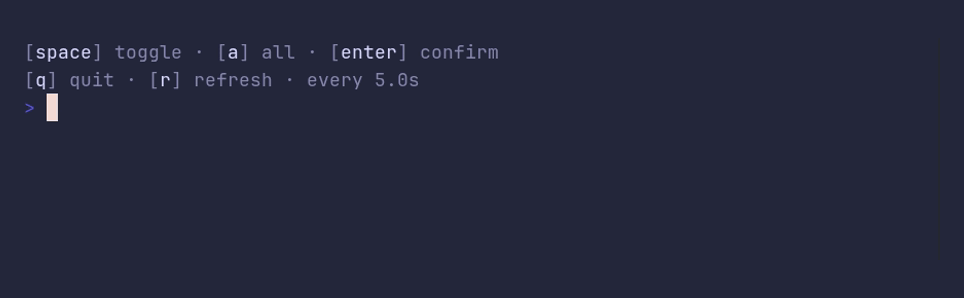

# keyhints/demo



```go
package main

import "github.com/pterm/pterm"

func main() {
	// Key hints tell the user which keys do what. Interactive printers
	// show them on their last line, and live views can use them too.
	pterm.KeyHints.WithHints(
		pterm.KeyHint{Key: "space", Desc: "toggle"},
		pterm.KeyHint{Key: "a", Desc: "all"},
		pterm.KeyHint{Key: "enter", Desc: "confirm"},
	).Render()

	// Entries without a key are plain information, such as a refresh rate.
	pterm.KeyHints.
		WithHint("q", "quit").
		WithHint("r", "refresh").
		WithHint("", "every 5.0s").
		Render()
}
```
