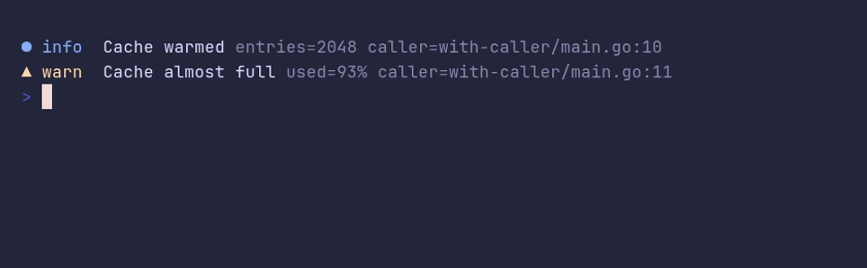

### logger/demo


<details>

<summary>SHOW SOURCE</summary>

```go
package main

import (
	"errors"
	"time"

	"github.com/pterm/pterm"
)

func main() {
	// The default level is Info. Trace shows every level.
	logger := pterm.Logger.WithLevel(pterm.LogLevelTrace)

	logger.Trace("Reading config", logger.Args("path", "./config.yaml"))
	logger.Debug("Config loaded", logger.ArgsFromMap(map[string]any{
		"workers": 4,
		"cache":   true,
	}))
	logger.Info("Server started", logger.Args("addr", ":8080", "env", "production"))

	time.Sleep(300 * time.Millisecond)

	logger.Warn("Slow request", logger.Args("path", "/api/search", "took", 1240*time.Millisecond))
	logger.Error("Payment failed", logger.Args("order", 1042, "error", errors.New("card declined")))

	// A line that is too long for the terminal puts its arguments on lines
	// of their own.
	logger.Info("Retrying the upload of the nightly backup to the secondary region",
		logger.Args("bucket", "s3://backups-eu-west", "attempt", 2, "reason", "connection reset by peer"))
}
```

</details>

### logger/json


<details>

<summary>SHOW SOURCE</summary>

```go
package main

import "github.com/pterm/pterm"

func main() {
	// The JSON formatter prints one object per line, for log collectors
	// that parse their input.
	logger := pterm.Logger.WithFormatter(pterm.LogFormatterJSON).WithTimeFormat("2006-01-02T15:04:05Z07:00")

	logger.Info("Server started", logger.Args("addr", ":8080", "env", "production"))
	logger.Warn("Slow request", logger.Args("path", "/api/search", "ms", 1240))
}
```

</details>

### logger/key-styles


<details>

<summary>SHOW SOURCE</summary>

```go
package main

import "github.com/pterm/pterm"

func main() {
	// Arguments are muted, except keys with a style of their own. "error"
	// and "err" are styled by default; AppendKeyStyle adds more.
	logger := pterm.Logger.AppendKeyStyle("user", pterm.ToneAccent.Style())

	logger.Info("Signed in", logger.Args("user", "ada", "method", "passkey"))
	logger.Error("Sign in failed", logger.Args("user", "grace", "error", "password expired"))
}
```

</details>

### logger/time


<details>

<summary>SHOW SOURCE</summary>

```go
package main

import (
	"time"

	"github.com/pterm/pterm"
)

func main() {
	// Lines have no time by default. WithTime adds it, muted, and
	// WithTimeFormat picks the layout.
	logger := pterm.Logger.WithTime().WithTimeFormat(time.DateTime)

	logger.Info("Job queued", logger.Args("job", "nightly-report"))
	time.Sleep(time.Second)
	logger.Info("Job finished", logger.Args("job", "nightly-report", "rows", 48213))
}
```

</details>

### logger/with-caller



<details>

<summary>SHOW SOURCE</summary>

```go
package main

import "github.com/pterm/pterm"

func main() {
	// WithCaller adds the file and line that logged, which helps to find
	// where a message comes from in a bigger program.
	logger := pterm.Logger.WithCaller()

	logger.Info("Cache warmed", logger.Args("entries", 2048))
	logger.Warn("Cache almost full", logger.Args("used", "93%"))
}
```

</details>

