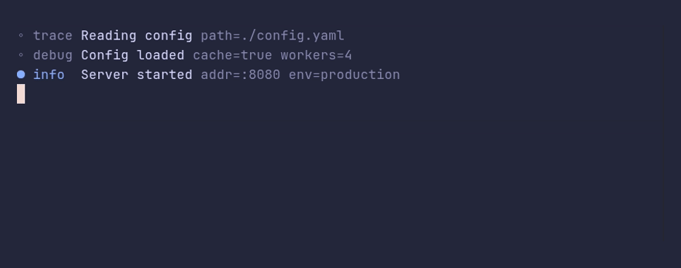

# logger/demo



```go
package main

import (
	"errors"
	"time"

	"github.com/pterm/pterm"
)

func main() {
	// The default level is Info. Trace shows every level.
	logger := pterm.Logger.WithLevel(pterm.LogLevelTrace)

	logger.Trace("Reading config", logger.Args("path", "./config.yaml"))
	logger.Debug("Config loaded", logger.ArgsFromMap(map[string]any{
		"workers": 4,
		"cache":   true,
	}))
	logger.Info("Server started", logger.Args("addr", ":8080", "env", "production"))

	time.Sleep(300 * time.Millisecond)

	logger.Warn("Slow request", logger.Args("path", "/api/search", "took", 1240*time.Millisecond))
	logger.Error("Payment failed", logger.Args("order", 1042, "error", errors.New("card declined")))

	// A line that is too long for the terminal puts its arguments on lines
	// of their own.
	logger.Info("Retrying the upload of the nightly backup to the secondary region",
		logger.Args("bucket", "s3://backups-eu-west", "attempt", 2, "reason", "connection reset by peer"))
}
```
