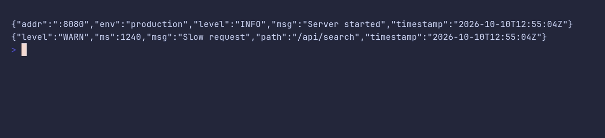

# logger/json



```go
package main

import "github.com/pterm/pterm"

func main() {
	// The JSON formatter prints one object per line, for log collectors
	// that parse their input.
	logger := pterm.Logger.WithFormatter(pterm.LogFormatterJSON).WithTimeFormat("2006-01-02T15:04:05Z07:00")

	logger.Info("Server started", logger.Args("addr", ":8080", "env", "production"))
	logger.Warn("Slow request", logger.Args("path", "/api/search", "ms", 1240))
}
```
