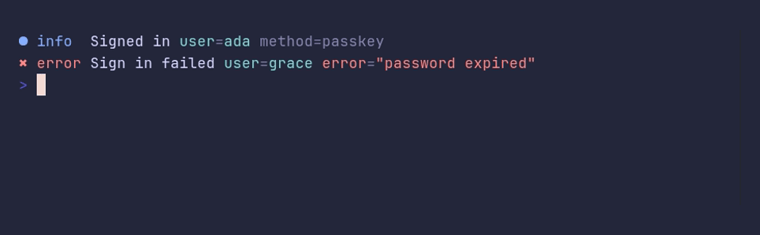

# logger/key-styles



```go
package main

import "github.com/pterm/pterm"

func main() {
	// Arguments are muted, except keys with a style of their own. "error"
	// and "err" are styled by default; AppendKeyStyle adds more.
	logger := pterm.Logger.AppendKeyStyle("user", pterm.ToneAccent.Style())

	logger.Info("Signed in", logger.Args("user", "ada", "method", "passkey"))
	logger.Error("Sign in failed", logger.Args("user", "grace", "error", "password expired"))
}
```
