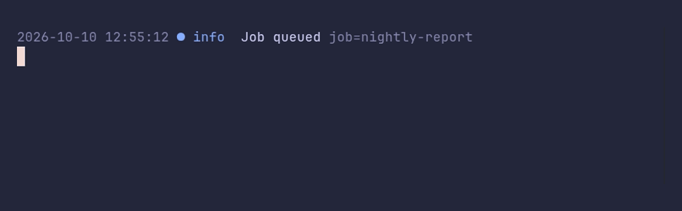

# logger/time



```go
package main

import (
	"time"

	"github.com/pterm/pterm"
)

func main() {
	// Lines have no time by default. WithTime adds it, muted, and
	// WithTimeFormat picks the layout.
	logger := pterm.Logger.WithTime().WithTimeFormat(time.DateTime)

	logger.Info("Job queued", logger.Args("job", "nightly-report"))
	time.Sleep(time.Second)
	logger.Info("Job finished", logger.Args("job", "nightly-report", "rows", 48213))
}
```
