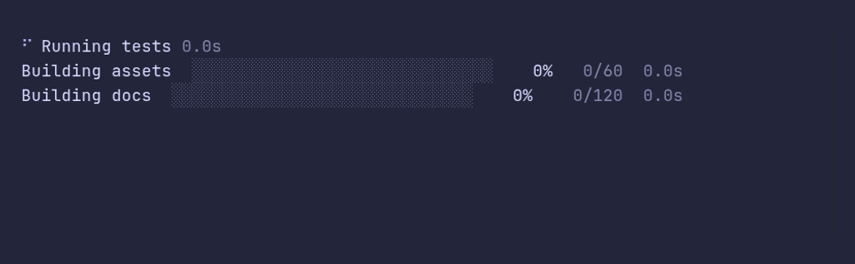

### multi/demo



<details>

<summary>SHOW SOURCE</summary>

```go
package main

import (
	"time"

	"github.com/pterm/pterm"
)

func main() {
	// Live printers stack on their own. A MultiPrinter only groups them, so
	// one Stop call ends whatever is still running.
	multi, _ := pterm.Multi.Start()

	tests, _ := pterm.Spinner.Start("Running tests")
	assets, _ := pterm.Progressbar.WithTotal(60).Start("Building assets")
	docs, _ := pterm.Progressbar.WithTotal(120).Start("Building docs")

	multi.Add(tests, assets, docs)

	for range 60 {
		time.Sleep(40 * time.Millisecond)
		assets.Increment()
		docs.Add(2)
	}

	// The bars stopped when they were full. Stop ends the spinner, and any
	// bar that was still running.
	multi.Stop()
}
```

</details>

