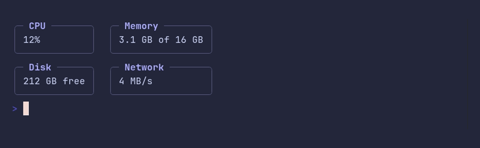

# panel/same-column-width



```go
package main

import "github.com/pterm/pterm"

func main() {
	// SameColumnWidth widens every panel to the widest one of its column,
	// so the frames of different rows line up.
	pterm.Panel.WithBoxed().WithSameColumnWidth().WithPanels(pterm.Panels{
		{
			{Title: "CPU", Data: "12%"},
			{Title: "Memory", Data: "3.1 GB of 16 GB"},
		},
		{
			{Title: "Disk", Data: "212 GB free"},
			{Title: "Network", Data: "4 MB/s"},
		},
	}).Render()
}
```
