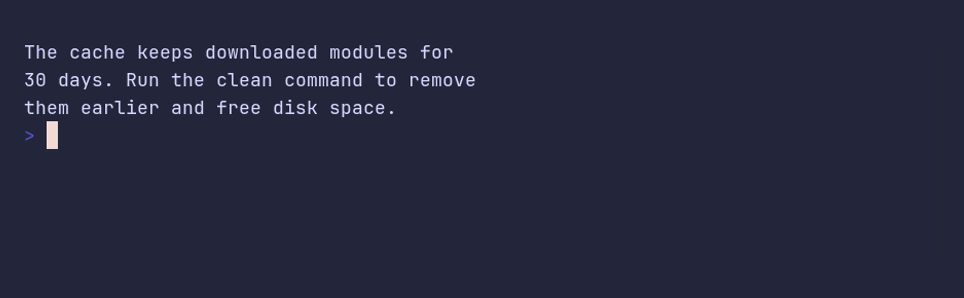

# paragraph/max-width



```go
package main

import "github.com/pterm/pterm"

func main() {
	// A narrow column suits short notes next to other output.
	pterm.Paragraph.WithMaxWidth(40).Println("The cache keeps downloaded modules for 30 days. Run the clean command to remove them earlier and free disk space.")
}
```
