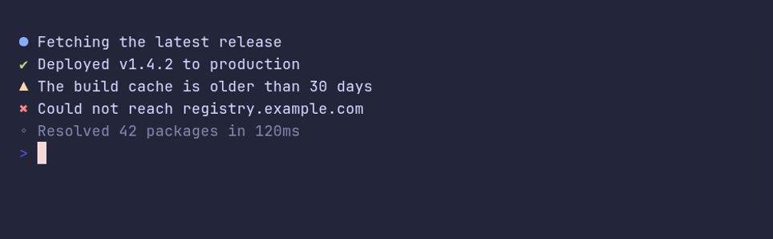

# prefix/demo



```go
package main

import "github.com/pterm/pterm"

func main() {
	pterm.Info.Println("Fetching the latest release")
	pterm.Success.Println("Deployed v1.4.2 to production")
	pterm.Warning.Println("The build cache is older than 30 days")
	pterm.Error.Println("Could not reach registry.example.com")

	// Debug output only shows up after EnableDebugMessages, for example
	// behind a --verbose flag.
	pterm.EnableDebugMessages()
	pterm.Debug.Println("Resolved 42 packages in 120ms")
}
```
