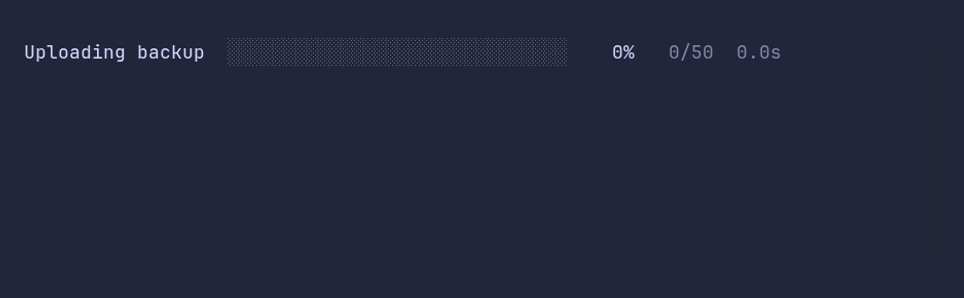

# progressbar/cancel



```go
package main

import (
	"context"
	"time"

	"github.com/pterm/pterm"
)

func main() {
	// The upload takes longer than the timeout allows, so the bar ends as
	// canceled when the context runs out.
	ctx, cancel := context.WithTimeout(context.Background(), 2*time.Second)
	defer cancel()

	bar, _ := pterm.Progressbar.WithTotal(50).WithContext(ctx).Start("Uploading backup")

	// Stop after the context ended prints the canceled line before main
	// returns.
	defer bar.Stop()

	for range 50 {
		select {
		case <-ctx.Done():
			return
		case <-time.After(100 * time.Millisecond):
			bar.Increment()
		}
	}
}
```
