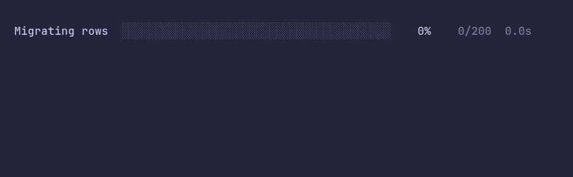

# progressbar/custom



```go
package main

import (
	"time"

	"github.com/pterm/pterm"
)

func main() {
	// Every part of the bar can be changed: here a green fill, a wider bar,
	// and no ETA because the work comes in uneven chunks.
	bar, _ := pterm.Progressbar.
		WithTotal(200).
		WithTone(pterm.ToneSuccess).
		WithBarWidth(40).
		WithShowETA(false).
		Start("Migrating rows")

	for range 20 {
		time.Sleep(100 * time.Millisecond)
		bar.Add(10)
	}

	// Without title, count and timer, only the bar and the percentage are
	// left.
	bar, _ = pterm.Progressbar.
		WithShowTitle(false).
		WithShowCount(false).
		WithShowElapsedTime(false).
		WithShowETA(false).
		Start()

	for range 100 {
		time.Sleep(20 * time.Millisecond)
		bar.Increment()
	}
}
```
