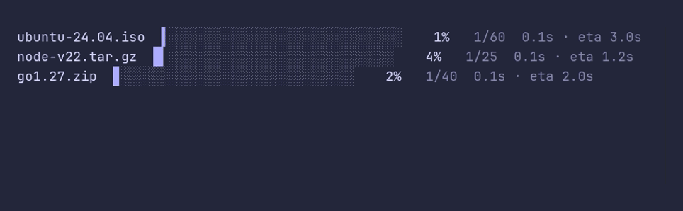

# progressbar/multiple



```go
package main

import (
	"sync"
	"time"

	"github.com/pterm/pterm"
)

func main() {
	downloads := []struct {
		name   string
		chunks int
	}{
		{"ubuntu-24.04.iso", 60},
		{"node-v22.tar.gz", 25},
		{"go1.27.zip", 40},
	}

	// Bars that run at the same time stack below each other on their own.
	var wg sync.WaitGroup

	for _, d := range downloads {
		bar, _ := pterm.Progressbar.WithTotal(d.chunks).Start(d.name)

		wg.Go(func() {
			for range d.chunks {
				time.Sleep(50 * time.Millisecond)
				bar.Increment()
			}
		})
	}

	wg.Wait()
}
```
