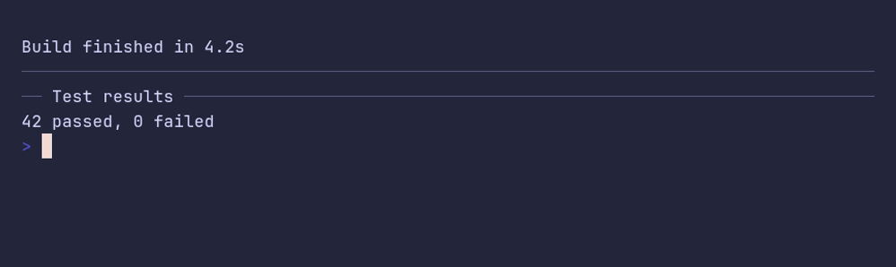

# rule/demo



```go
package main

import "github.com/pterm/pterm"

func main() {
	// A rule separates parts of the output without the weight of a section
	// title. It spans the terminal.
	pterm.Text.Println("Build finished in 4.2s")
	pterm.Rule.Println()

	// The text becomes a title inside the rule.
	pterm.Rule.Println("Test results")
	pterm.Text.Println("42 passed, 0 failed")
}
```
