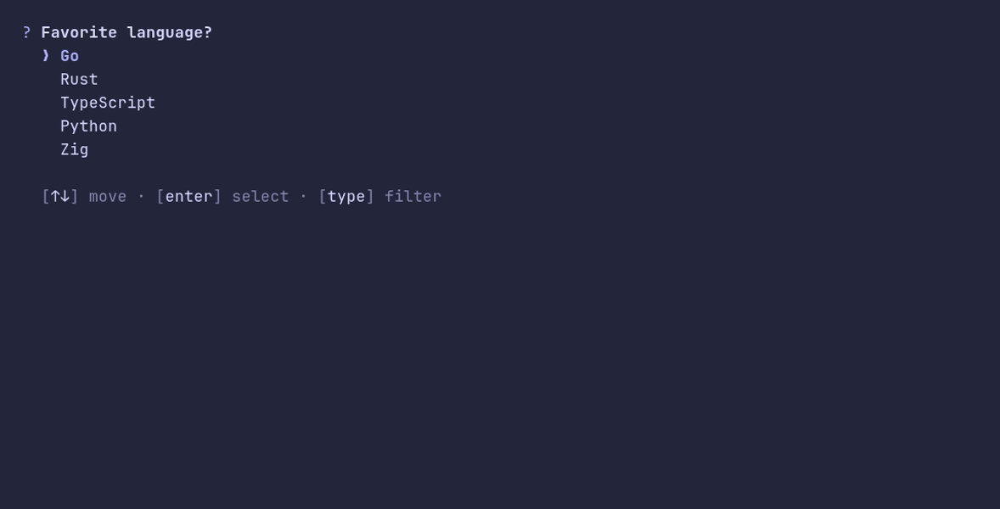

# select/options



```go
package main

import "github.com/pterm/pterm"

func main() {
	// A plain list of strings is all a select needs. The default option is
	// where the cursor starts, and what Show returns without asking when
	// the program does not run in a terminal.
	language, _ := pterm.Select.
		WithOptions([]string{"Go", "Rust", "TypeScript", "Python", "Zig"}).
		WithDefaultOption("Go").
		Show("Favorite language?")

	pterm.Info.Printfln("You picked %s", language)
}
```
