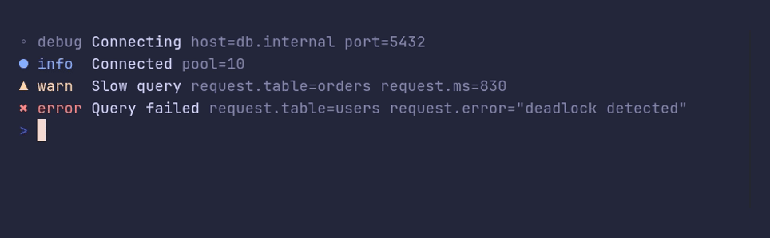

### slog/demo



<details>

<summary>SHOW SOURCE</summary>

```go
package main

import (
	"log/slog"

	"github.com/pterm/pterm"
)

func main() {
	// pterm's logger works as a handler for log/slog, so code that already
	// logs with slog gets the same look.
	handler := pterm.NewSlogHandler(pterm.Logger.WithLevel(pterm.LogLevelDebug))
	logger := slog.New(handler)

	logger.Debug("Connecting", "host", "db.internal", "port", 5432)
	logger.Info("Connected", "pool", 10)

	// Groups turn into dotted keys.
	requests := logger.WithGroup("request")
	requests.Warn("Slow query", "table", "orders", "ms", 830)
	requests.Error("Query failed", "table", "users", "error", "deadlock detected")
}
```

</details>

