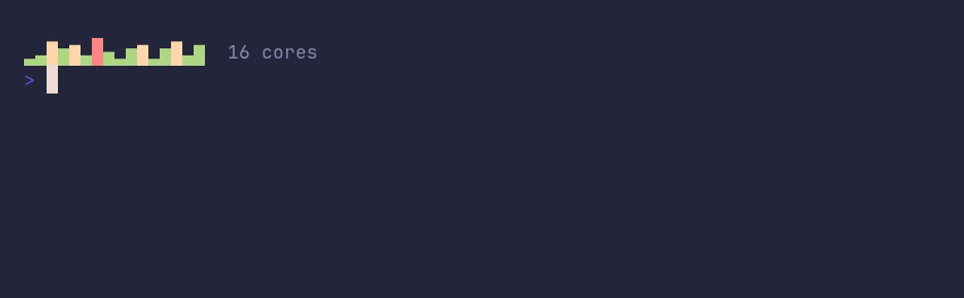

# sparkline/thresholds



```go
package main

import "github.com/pterm/pterm"

func main() {
	// Load per CPU core. A fixed range of 0 to 100 makes the thresholds
	// mean percent, and each column is toned by its own level.
	pterm.Sparkline.
		WithValues(12, 34, 88, 56, 71, 23, 95, 41, 8, 63, 77, 19, 50, 82, 30, 67).
		WithRange(0, 100).
		WithThresholds(pterm.LoadThresholds()...).
		WithLabel("16 cores").
		Render()
}
```
