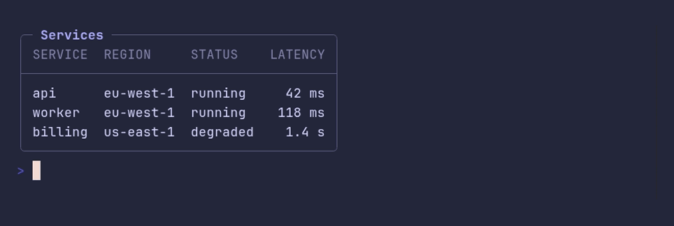

# table/boxed



```go
package main

import "github.com/pterm/pterm"

func main() {
	// A boxed table gets a rounded frame with its title inset into the top
	// edge. Use it when the table has to stand apart from the output around it.
	pterm.Table.WithBoxed().WithTitle("Services").WithData(pterm.TableData{
		{"Service", "Region", "Status", "Latency"},
		{"api", "eu-west-1", "running", "42 ms"},
		{"worker", "eu-west-1", "running", "118 ms"},
		{"billing", "us-east-1", "degraded", "1.4 s"},
	}).Render()
}
```
