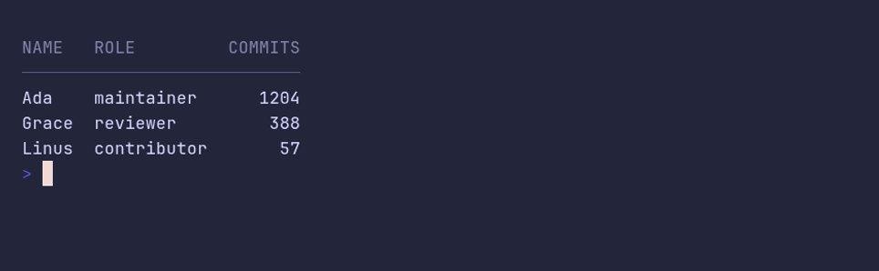

# table/from-csv



```go
package main

import (
	"encoding/csv"
	"strings"

	"github.com/pterm/pterm"
)

func main() {
	data := `Name,Role,Commits
Ada,maintainer,1204
Grace,reviewer,388
Linus,contributor,57`

	// WithCSVReader reads every record. The CSV header line becomes the
	// table header.
	pterm.Table.WithCSVReader(csv.NewReader(strings.NewReader(data))).Render()
}
```
