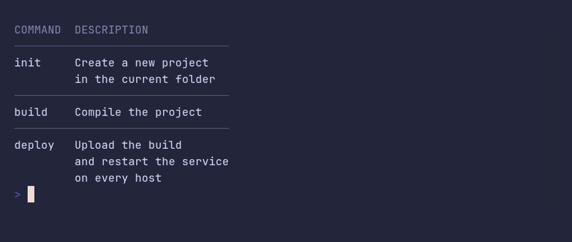

# table/multiple-lines



```go
package main

import "github.com/pterm/pterm"

func main() {
	// Cells can hold several lines. A row grows to fit its tallest cell, and
	// row separators keep the rows apart.
	pterm.Table.WithRowSeparators().WithData(pterm.TableData{
		{"Command", "Description"},
		{"init", "Create a new project\nin the current folder"},
		{"build", "Compile the project"},
		{"deploy", "Upload the build\nand restart the service\non every host"},
	}).Render()
}
```
