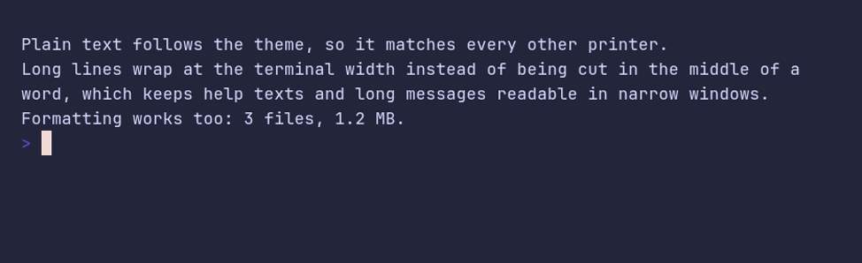

# text/demo



```go
package main

import "github.com/pterm/pterm"

func main() {
	// Text prints like fmt, but in the theme's text color, and long lines
	// wrap at word boundaries to fit the terminal.
	pterm.Text.Println("Plain text follows the theme, so it matches every other printer.")
	pterm.Text.Println("Long lines wrap at the terminal width instead of being cut in the middle of a word, which keeps help texts and long messages readable in narrow windows.")
	pterm.Text.Printfln("Formatting works too: %d files, %s.", 3, "1.2 MB")
}
```
