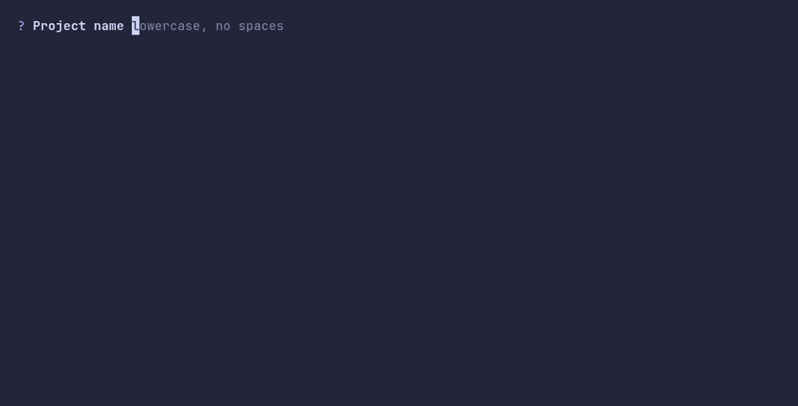

# textinput/demo



```go
package main

import "github.com/pterm/pterm"

func main() {
	// A single-line input. The placeholder shows what is expected and
	// disappears with the first key press; enter submits.
	name, _ := pterm.TextInput.
		WithPlaceholder("lowercase, no spaces").
		Show("Project name")

	pterm.Success.Printfln("Created %s", name)
}
```
