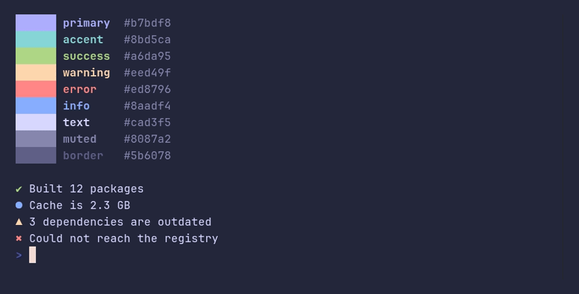
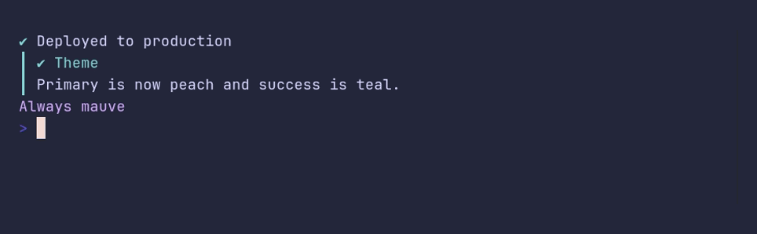
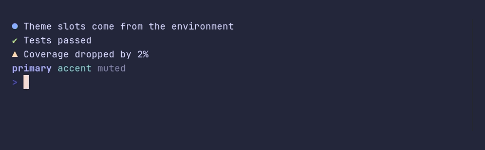

### theme/demo



<details>

<summary>SHOW SOURCE</summary>

```go
package main

import (
	"fmt"

	"github.com/pterm/pterm"
)

func main() {
	// Every printer colors itself from the nine theme slots, so this list is
	// the whole palette pterm draws with.
	tones := []pterm.Tone{
		pterm.TonePrimary, pterm.ToneAccent, pterm.ToneSuccess,
		pterm.ToneWarning, pterm.ToneError, pterm.ToneInfo,
		pterm.ToneText, pterm.ToneMuted, pterm.ToneBorder,
	}

	for _, tone := range tones {
		swatch := pterm.NewStyle(pterm.ToneDefault).On(tone).Sprint("      ")
		fmt.Printf("%s %s %s\n", swatch, tone.Bold().Sprintf("%-8s", tone), pterm.ToneMuted.Sprint(tone.Color()))
	}

	fmt.Println()

	// Status messages pick their tone from the same slots.
	pterm.Success.Println("Built 12 packages")
	pterm.Info.Println("Cache is 2.3 GB")
	pterm.Warning.Println("3 dependencies are outdated")
	pterm.Error.Println("Could not reach the registry")
}
```

</details>

### theme/custom



<details>

<summary>SHOW SOURCE</summary>

```go
package main

import (
	"atomicgo.dev/color"

	"github.com/pterm/pterm"
)

func main() {
	// Start from a preset and change the slots you care about. Every printer
	// picks up the new theme, there is nothing else to restyle.
	theme := pterm.ThemeMacchiato
	theme.Primary = color.RGB(0xf5, 0xa9, 0x7f) // peach
	theme.Success = color.RGB(0x8b, 0xd5, 0xca) // teal

	pterm.SetTheme(theme)

	pterm.Success.Println("Deployed to production")
	pterm.Callout.Tip("Theme").Println("Primary is now peach and success is teal.")

	// Tones can also be fixed to a color that ignores the theme.
	pterm.Println(pterm.Fixed(color.RGB(0xc6, 0xa0, 0xf6)).Sprint("Always mauve"))
}
```

</details>

### theme/env



<details>

<summary>SHOW SOURCE</summary>

```go
package main

import (
	"github.com/pterm/pterm"
)

// Run this example with different environment variables to see the theme
// change without touching the code:
//
//	PTERM_THEME=latte go run .
//	PTERM_THEME=ansi go run .
//	PTERM_THEME_PRIMARY=#f5a97f PTERM_THEME_SUCCESS=cyan go run .
//
// PTERM_THEME defaults to "auto", which asks the terminal for its
// background color and picks Latte on light backgrounds.
func main() {
	pterm.Info.Println("Theme slots come from the environment")
	pterm.Success.Println("Tests passed")
	pterm.Warning.Println("Coverage dropped by 2%")
	pterm.Println(pterm.TonePrimary.Bold().Sprint("primary"), pterm.ToneAccent.Sprint("accent"), pterm.ToneMuted.Sprint("muted"))
}
```

</details>

