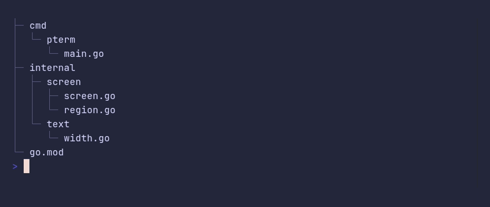

# tree/from-indented



```go
package main

import (
	"github.com/pterm/pterm"
	"github.com/pterm/pterm/putils"
)

func main() {
	// Write the tree the way you would sketch it in a README. Each level
	// only has to be indented further than its parent.
	files := putils.TreeFromIndented(`
cmd
  pterm
    main.go
internal
  screen
    screen.go
    region.go
  text
    width.go
go.mod`)

	_ = pterm.Tree.WithRoot(files).Render()
}
```
