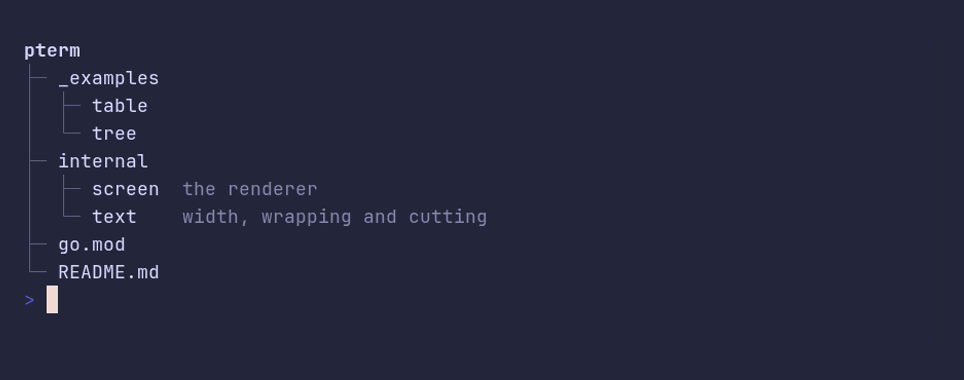

# tree/root



```go
package main

import "github.com/pterm/pterm"

func main() {
	// The text of the root goes on the first line, above its children.
	pterm.Tree.WithRoot(pterm.TreeNode{
		Text: "pterm",
		Children: []pterm.TreeNode{
			{Text: "_examples", Children: []pterm.TreeNode{
				{Text: "table"},
				{Text: "tree"},
			}},
			{Text: "internal", Children: []pterm.TreeNode{
				{Text: "screen", Description: "the renderer"},
				{Text: "text", Description: "width, wrapping and cutting"},
			}},
			{Text: "go.mod"},
			{Text: "README.md"},
		},
	}).Render()
}
```
